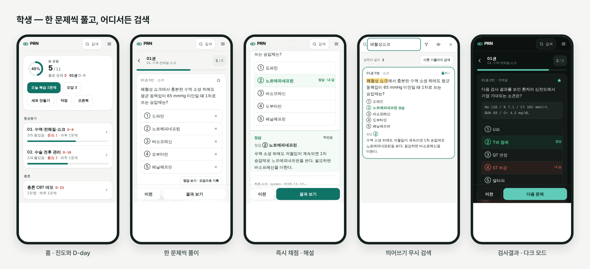

# 최성민 · 포트폴리오

기획부터 설계, 개발, 배포, 운영까지 직접 맡아 실제 사용자에게 내놓은 프로젝트를 모았습니다.

---

## 프로젝트

<table>
<tr>
<td width="42%" valign="top">

</td>
<td valign="top">

### [PRN — 필요할 때 꺼내 쓰는 문제은행](projects/prn/)

외과 시험 문항 1,600여 개를 한 문제씩 풀고, 어디서든 바로 검색하고, 관리자가 검수해 올리는 모바일 문제은행.

- 흩어진 시험 자료(PDF·HTML·캡처)를 파싱해 **draft → 검수 → verified** 파이프라인으로
- 한국어 검색 정규화 — SQL과 브라우저 구현을 **전 유니코드에서 일치**시키는 생성기
- 권한·채점·수정 이력을 **DB(RLS·RPC·트리거)가 지키는** 보안 설계
- 단위·SQL·브라우저 E2E 테스트, 가짜 Supabase 게이트웨이로 키 없이 끝까지 테스트

`2026.09 – 2026.11` · 개인 프로젝트 · [자세히 보기 →](projects/prn/) · [발표 자료 PDF](projects/prn/PRN-portfolio.pdf)

</td>
</tr>
</table>

<!--
다음 프로젝트는 위 <table> 을 복사해 projects/<이름>/ 으로 추가한다.
-->
