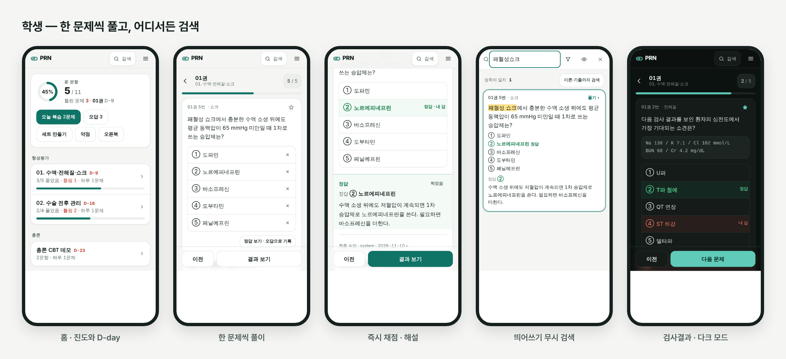
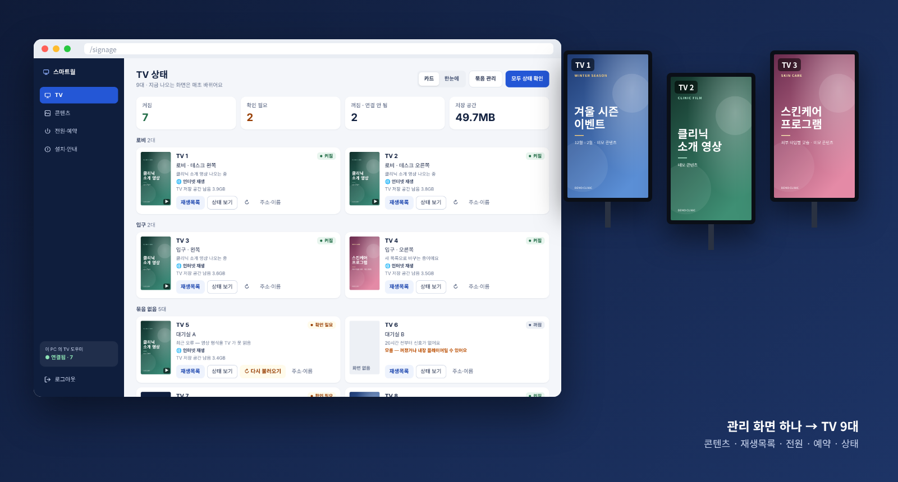

# 최성민 · 포트폴리오

직접 기획·개발·운영한 서비스와 팀 프로젝트에서 맡은 구현을 모았습니다.
회원·인증, 업무 규칙, 데이터 권한과 여러 기기의 상태를 연결하는 경험을 소개합니다.

---

## 프로젝트 한눈에 보기

| 프로젝트 | 다룬 문제 | 내 역할 | 상세 |
|---|---|---|---|
| **PRN** | 모바일 문제 풀이·검색·문항 검수 | 개인 개발 | [보기](projects/prn/) |
| **스마트월** | 병원 내부망 TV의 콘텐츠·전원 관리 | 개인 개발 | [보기](projects/smartwall/) |
| **리쥬베리 워크스페이스** | 근무·신청·승인·마감과 병원 운영 도구 | 개인 개발 | [보기](projects/rejuberry/) |
| **모아봄** | 공유 일정·기록·반복·오프라인 동기화 | 개인 개발 | [보기](projects/moabom/) |
| **전지천 퀴즈** | QR 참여와 강의 중 응답 분포 집계 | 개인 개발 | [보기](projects/jeonjicheon-quiz/) |
| **Medicine WMS** | CLI에서 회원 유형·승인에 따른 업무 진입 | 팀 · 로그인·회원관리 | [보기](projects/medicine-wms/) |
| **All Live Young** | 웹 WMS의 회원 업무와 문의·답변 | 팀 · 회원관리·고객센터 | [보기](projects/all-live-young/) |
| **CROFLE** | 라이브 펀딩 서비스의 로그인·프론트엔드 | 팀 · AAA | [화면](projects/crofle/) · [인증 API](projects/live-crowdfunding-backend/) |

> CROFLE 프론트엔드와 백엔드는 같은 팀 프로젝트를 담당 영역별로 설명합니다.
> 스마트월은 리쥬베리 워크스페이스에서 확장한 TV 관리 기능의 상세 사례입니다.

## 대표 개인 프로젝트

<table>
<tr>
<td width="42%" valign="top">

</td>
<td valign="top">

### [PRN — 필요할 때 꺼내 쓰는 문제은행](projects/prn/)

외과 시험 문항 1,600여 개를 한 문제씩 풀고, 어디서든 바로 검색하고, 관리자가 검수해 올리는 모바일 문제은행.

- 흩어진 시험 자료(PDF·HTML·캡처)를 파싱해 **draft → 검수 → verified** 파이프라인으로
- 한국어 검색 정규화 — SQL과 브라우저 구현을 **전 유니코드에서 일치**시키는 생성기
- 권한·채점·수정 이력을 **DB(RLS·RPC·트리거)가 지키는** 보안 설계
- 단위·SQL·브라우저 E2E 테스트, 가짜 Supabase 게이트웨이로 키 없이 끝까지 테스트

`2026.09 – 2026.11` · 개인 프로젝트 · [자세히 보기 →](projects/prn/) · [발표 자료 PDF](projects/prn/PRN-portfolio.pdf)

</td>
</tr>
</table>

<table>
<tr>
<td width="42%" valign="top">

</td>
<td valign="top">

### [스마트월: 병원 대기실 사이니지 TV 9대를 웹에서 관리하기](projects/smartwall/)

TV마다 USB를 꽂아 바꾸던 콘텐츠를 웹에서 올리고, 전원과 예약까지 관리 화면에서 다루게 만들었습니다.

- 클라우드에서 닿지 않는 병원 내부망 TV를 병원 PC 도우미(Python)를 거쳐 켜고 끕니다
- 저장 공간이 80MB인 TV 브라우저에서 영상이 끊기던 문제를 상태 보고로 원인을 찾아 고쳤습니다
- 영상을 올릴 때 브라우저에서 TV 해상도로 다시 만들어, 4K 영상 5개 용량을 208.7MB에서 59.7MB로 줄였습니다

`2026.11` 1인 개발 &nbsp; [자세히 보기](projects/smartwall/) &nbsp; [발표 자료 PDF](projects/smartwall/SmartWall-portfolio.pdf)

</td>
</tr>
</table>

## 운영·사용자 서비스

### [리쥬베리 워크스페이스 — 병원 운영 업무를 한곳에서](projects/rejuberry/)

근무표·연차·오버타임·인사 업무를 연결하고, 재고·마케팅·스마트월까지 확장한 사내 도구입니다.

- 기존 입력을 보존하고 예외와 요약을 반환하는 **근무표 생성기**
- 일반 목록과 관리용 조회를 나눈 **개인정보·역할별 접근 설계**
- 월별 **마감값과 이후 정정 이력**을 구분하는 운영 흐름

`React` · `TypeScript` · `Supabase` · `PostgreSQL` · [자세히 보기 →](projects/rejuberry/)

### [모아봄 — 함께 쓰는 일정과 기록장](projects/moabom/)

공유 캘린더에 일정과 다녀온 곳·본 콘텐츠를 모으는 웹·모바일 앱입니다.

- 양력·음력 **반복 일정과 회차별 편집**
- 작업 ID와 기준 버전을 사용하는 **오프라인 변경 동기화**
- ICS 구독·위젯 API와 웹·네이티브의 **공통 날짜 fixture**

`Next.js` · `TypeScript` · `Supabase` · `Kotlin` · `Swift` · [자세히 보기 →](projects/moabom/)

### [전지천 퀴즈 — QR로 참여하는 실시간 응답 집계](projects/jeonjicheon-quiz/)

청중이 휴대폰으로 답하면 문항별 응답 분포를 발표 화면에 모아 보여줍니다.

- 객관식 5개·주관식 1개, **회차별 응답과 주관식 정규화**
- 참여 화면과 발표 화면을 분리하고 **Realtime으로 집계 갱신**
- 점수·순위보다 강의 중 전체 응답 분포에 집중

`JavaScript` · `Supabase Realtime` · `HTML/CSS` · [자세히 보기 →](projects/jeonjicheon-quiz/)

## 팀 프로젝트 — 내가 맡은 구현

### [Medicine WMS — 로그인·회원관리](projects/medicine-wms/)

일반회원·배송기사·관리자의 가입 정보를 구분하고, 승인 상태를 확인해 업무 메뉴에 연결했습니다.
회원 조회·수정과 계정 찾기·비밀번호 변경을 Java·JDBC로 구현했습니다.

`Java` · `JDBC` · `MySQL` · [자세히 보기 →](projects/medicine-wms/)

### [All Live Young — 회원관리·고객센터](projects/all-live-young/)

회원 가입·상태 관리와 문의·답변·공지사항을 담당했습니다. Spring MVC·MyBatis 계층으로 요청과 SQL을 나누고, 답변 저장과 문의 상태 변경을 트랜잭션으로 묶었습니다.

`Spring Boot` · `MyBatis` · `Thymeleaf` · `MySQL` · [자세히 보기 →](projects/all-live-young/)

### CROFLE — 로그인·프론트엔드와 인증 API

라이브 크라우드펀딩 팀에서 AAA 역할을 맡았습니다. Vue의 로그인·가입·계정 복구 화면과 함께, 회원·JWT 토큰·Redis 상태·네이버 로그인을 연결했습니다.

- [프론트엔드 — 화면·라우트·API 연결](projects/crofle/)
- [백엔드 — 회원·토큰 갱신·계정 복구](projects/live-crowdfunding-backend/)

`Vue` · `Spring Boot` · `JPA` · `JWT` · `Redis`

---

작성 기준과 코드 확인 범위

추가한 상세 문서는 실제 소스·커밋과 본인이 확인한 역할을 바탕으로 작성했습니다.
개인 담당 범위와 팀 전체 기능을 구분하며, 실행하지 않은 테스트나 측정하지 않은 운영 수치를 성과로 쓰지 않았습니다.
비공개 프로젝트는 코드·운영 데이터 대신 구현 방식과 설계만 소개합니다.

[코드 검토·저장소 비교·역할 확인 근거](docs/project-review.md)

