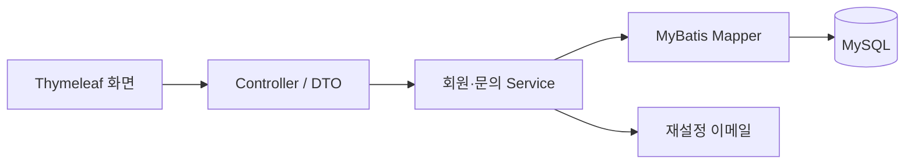

# All Live Young — 의약품 WMS의 회원관리와 고객센터

**CLI에서 다뤘던 회원 업무를 Spring 웹 서비스로 확장하고, 회원과 운영자가 문의·답변을 주고받는 고객센터를 구현했습니다.**

[전체 포트폴리오](../../README.md) · [본인 저장소](https://github.com/firstsm41/all-live-young) · [팀 저장소](https://github.com/ceo92/all-live-young) · [함께 검토한 EdenKwon 저장소](https://github.com/EdenKwon/all-live-young)

| 항목 | 내용 |
|---|---|
| 유형 | 교육 과정 팀 프로젝트 · 의약품 창고 관리 웹 서비스 |
| 담당 | 회원관리, 고객센터 |
| 기술 | Java 17, Spring Boot 3.3.4, Spring MVC, MyBatis, MySQL, Thymeleaf |
| 연계 구성 | 팀 공통 Spring Security 인증·권한 처리 |
| 구현 시기 | 2024년 9~10월 |

## 프로젝트와 나의 역할

All Live Young은 입고·출고·재고·창고·재무 업무를 제공하는 의약품 WMS입니다. 이 중 저는 회원의 가입·정보 변경·상태 관리와 문의·답변·공지사항을 다루는 고객센터를 맡았습니다.

팀 전체 물류 기능과 제가 담당한 회원·고객센터 기능을 분리해 설명합니다.

## 내가 구현한 부분

| 영역 | 주요 내용 |
|---|---|
| 회원 가입·상태 | 가입 승인 대기 상태, 회원 상세·수정, 탈퇴 요청, 조건별 회원 검색 |
| 계정 복구 | 회원 식별정보를 통한 계정 찾기, 만료시간이 있는 재설정 토큰과 이메일 링크 |
| 사용자 문의 | 문의 작성·수정·삭제, 본인 문의 목록과 상세 |
| 운영자 답변 | 답변 작성·수정·삭제, 미답변 문의 조회, 문의의 답변 상태 갱신 |
| 공지사항 | 공지 작성·조회·수정·삭제와 관련 화면 |

## 설명하고 싶은 구현

### 화면 요청부터 SQL까지 역할 나누기

컨트롤러는 요청과 화면 연결을, DTO는 전달할 값을, 서비스는 회원·문의 처리를, Mapper는 SQL 실행을 담당하도록 구성했습니다. 회원 검색 조건과 문의의 상태 변경을 화면 코드에 직접 넣지 않고 서비스와 매핑 계층으로 나눴습니다.

### 답변과 문의 상태를 함께 바꾸기

답변을 등록하면 문의의 답변 여부도 바뀌어야 합니다. `InquiryServiceImpl`에서는 답변 저장과 문의 상태 변경을 같은 트랜잭션으로 묶었습니다. 답변을 삭제할 때도 상태를 다시 변경해 미답변 목록과 실제 답변 데이터가 어긋나지 않도록 처리했습니다.

문의·답변을 수정하거나 삭제할 때에는 기존 데이터의 작성자 식별값과 요청자의 식별값을 비교하는 로직을 서비스에 두었습니다.

### 계정 복구를 별도 흐름으로 만들기

재설정 요청을 받으면 회원을 확인하고, 만료시간이 있는 토큰을 저장한 뒤 이메일 링크를 보냅니다. 변경 단계에서는 토큰의 존재·만료를 확인하고 사용한 토큰을 삭제합니다. 단순한 회원 수정과 계정 복구가 다른 절차라는 점을 다뤘습니다.

## 돌아보면

당시 코드는 학습 프로젝트이므로 운영 수준의 보안 완성을 주장하지 않습니다. 특히 가입·변경·재설정 경로에서 비밀번호 저장 방식이 일관되게 해시를 적용하도록 보완하고, 역할·작성자·요청 조합별 회귀 테스트를 추가할 필요가 있습니다.

## 코드와 개인 기여 근거

- [`MemberServiceImpl.java`](https://github.com/firstsm41/all-live-young/blob/e0a123a7dacaa82ecad02d7ae3a53e2752b90966/src/main/java/allliveyoung/wms/service/MemberServiceImpl.java): 회원 상태·계정 복구
- [`InquiryServiceImpl.java`](https://github.com/firstsm41/all-live-young/blob/e0a123a7dacaa82ecad02d7ae3a53e2752b90966/src/main/java/allliveyoung/wms/service/InquiryServiceImpl.java): 문의·답변과 트랜잭션
- [`MemberMapper.xml`](https://github.com/firstsm41/all-live-young/blob/e0a123a7dacaa82ecad02d7ae3a53e2752b90966/src/main/resources/allliveyoung/wms/mapper/MemberMapper.xml): 회원 SQL 매핑
- [회원·고객센터 서비스 작업](https://github.com/firstsm41/all-live-young/commit/f5986b52f4cd43339a706edbdcc7df5668a68e83), [문의·공지 컨트롤러 추가](https://github.com/firstsm41/all-live-young/commit/3f4caf4be8d2777f8c5d5da362e137f517d79819): `CSM` 작성자와 `firstsm41` 계정 연결 확인

EdenKwon README의 입고 기능·회고는 해당 팀원의 기록입니다. 개인 기여로 옮기지 않았습니다.
