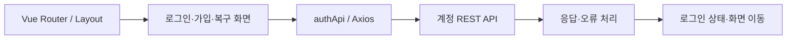

# CROFLE — 라이브 크라우드펀딩 프론트엔드

**서비스에 들어오는 첫 단계인 로그인·가입·계정 복구 화면을 만들고, Vue 화면을 백엔드 인증 API와 연결했습니다.**

[전체 포트폴리오](../../README.md) · [초기 프론트엔드](https://github.com/firstsm41/CROFLE_FRONT_NEW) · [팀 최종 프론트엔드](https://github.com/ssg-ic-project/Live-CrowdFunding-Frontend) · [백엔드 담당 내용](../live-crowdfunding-backend/README.md)

| 항목 | 내용 |
|---|---|
| 유형 | 팀 프로젝트 · 라이브 크라우드펀딩 |
| 담당 | 팀원 AAA — 로그인·프론트엔드 |
| 기술 | Vue 3, JavaScript, Vue Router, Axios, Vite |
| 구현 시기 | 2024년 11~12월 |

## 어떤 서비스인가

CROFLE은 펀딩 상품을 탐색하고, 판매자의 라이브 방송과 소통을 통해 상품을 이해한 뒤 펀딩에 참여하는 서비스입니다. 저는 이 흐름에 들어오는 계정 화면과 프론트엔드 연결을 맡았습니다.

`CROFLE_FRONT_NEW`는 화면과 인증 연동을 작업한 초기 코드이고, 최종 팀 저장소에는 방송·채팅·결제 등 다른 팀원의 기능이 통합돼 있습니다. 두 저장소를 별개의 완성 서비스로 세지 않습니다.

## 내가 맡은 화면과 연결

- 이메일 로그인, 입력값 확인, 실패 응답 안내
- 일반 사용자·판매자 가입 폼과 관련 인증 UI
- 아이디 찾기, 비밀번호 재설정 요청·확인 화면
- 네이버 로그인 진입과 콜백 결과 처리
- API 클라이언트의 Bearer 토큰 전달과 인증 오류 처리
- 공통 레이아웃과 화면 경로 연결, 팀 통합 과정의 화면·스타일 수정

## 구현 포인트

### 화면과 API 호출 분리

폼의 표시와 입력 처리는 Vue 페이지에서, 로그인·계정 찾기·재설정 요청은 `authApi.js`에서 처리합니다. 공통 Axios 설정에는 인증 헤더 전달과 인증 오류 시 로그인 화면으로 돌아가는 처리를 모았습니다.

### 하나의 로그인 버튼 이후를 연결하기

로그인 응답을 받은 뒤에는 토큰과 사용자 정보를 반영하고, 로그인 전 방문 경로를 고려해 화면을 이동시켜야 합니다. 소셜 로그인은 외부 인증 화면을 거쳐 돌아오기 때문에 콜백에서도 로그인 상태가 이어지도록 처리했습니다.

### 서로 다른 화면 영역을 구성하기

일반 사용자·마이페이지·관리자 화면을 레이아웃과 라우트로 구분했습니다. 로그인이나 계정 복구는 별도 인증 영역에서 다루고, 팀 기능이 합쳐진 최종 프론트엔드에서도 화면 경로와 스타일을 조정했습니다.

## 돌아보면

초기 API 모듈에는 중복 정의가 있고, 초기 화면과 최종 백엔드의 일부 경로도 다시 맞춰 볼 필요가 있습니다. 브라우저 저장소와 라우터 가드는 화면 편의를 위한 처리이며 서버 권한 검증을 대신하지 않습니다. 다시 정리한다면 API 계약을 먼저 고정하고 로그인·소셜 콜백·복구 경로를 묶은 E2E 테스트를 추가하겠습니다.

## 코드와 개인 기여 근거

- [`src/views/auth`](https://github.com/firstsm41/CROFLE_FRONT_NEW/tree/d24e073cd2188b00bfa15a29887c775155c610b6/src/views/auth): 로그인·가입·복구·콜백 화면
- [`authApi.js`](https://github.com/firstsm41/CROFLE_FRONT_NEW/blob/d24e073cd2188b00bfa15a29887c775155c610b6/src/api/authApi.js), [`axios.js`](https://github.com/firstsm41/CROFLE_FRONT_NEW/blob/d24e073cd2188b00bfa15a29887c775155c610b6/src/api/axios.js): API 연결
- [`router/index.js`](https://github.com/firstsm41/CROFLE_FRONT_NEW/blob/d24e073cd2188b00bfa15a29887c775155c610b6/src/router/index.js): 라우트·레이아웃 연결
- [초기 인증 오류 수정](https://github.com/firstsm41/CROFLE_FRONT_NEW/commit/86633d7d5c84e3b187c60d5b48408b91687151e0), [팀 최종 화면 경로 수정](https://github.com/ssg-ic-project/Live-CrowdFunding-Frontend/commit/a8423989f82d64afddc6309d24f5fd943ed73ec5): `firstsm41` 변경 이력
