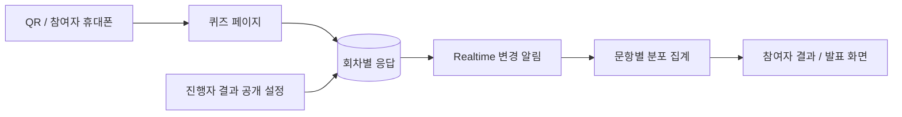

# 전지천 퀴즈 — QR로 참여하는 실시간 응답 집계

**강의 중 휴대폰으로 답한 결과를 모아, 진행자가 큰 화면에서 문항별 응답 분포를 보여주는 웹앱입니다.**

[전체 포트폴리오](../../README.md) · [소스 코드](https://github.com/firstsm41/jeonjicheon-quiz) · [퀴즈](https://firstsm41.github.io/jeonjicheon-quiz/) · [발표 화면](https://firstsm41.github.io/jeonjicheon-quiz/present.html)

| 항목 | 내용 |
|---|---|
| 유형·담당 | 개인 프로젝트 · 참여 화면, 진행·발표 화면, 응답 저장·집계 |
| 기술 | HTML, CSS, JavaScript, Supabase PostgreSQL·Realtime, PWA manifest |
| 확인한 문항 구성 | 객관식 5개 + 주관식 1개 |
| 사용 맥락 | 강의 중 QR 참여와 문항별 인식·응답 현황 공유 |

## 어떤 문제를 해결했나

청중의 답을 손들기나 종이로 받으면 전체 분포를 바로 보기 어렵습니다. 참여자는 QR로 열어 답하고, 진행자는 발표용 화면에서 한 문항씩 결과를 보여주도록 만들었습니다.

개인 점수나 순위를 매기는 앱이 아니라 **어떤 문항에 어떻게 응답했는지**를 함께 확인하는 도구입니다.

## 주요 기능

- 모바일 퀴즈와 객관식·주관식 응답
- QR 이미지와 안내 포스터 페이지
- 회차별 응답 저장·조회
- 새 응답과 결과 공개 설정의 실시간 반영
- 방향키·클릭으로 넘기는 발표 전용 화면
- 설정이 없을 때 한 기기에서 확인할 수 있는 로컬 동작
- manifest와 아이콘을 통한 홈 화면 추가

## 구현 포인트

### 참여 화면과 발표 화면 분리

참여자는 한 문항씩 답하고, 진행자는 넓은 화면에서 결과를 설명합니다. 두 화면은 같은 문항 데이터와 응답을 사용하지만 표시 방식과 조작을 다르게 구성했습니다.

### 선택지와 주관식 응답을 다르게 집계

객관식은 선택지별 인원과 비율을 보여주고, 주관식은 공백·대소문자 등을 정규화해 응답을 묶습니다. 회차 식별값을 함께 저장해 다른 강의의 응답이 섞이지 않게 했습니다.

### 집계 갱신과 결과 노출을 구분

새 응답이 들어오면 집계를 갱신하고, 참가자의 결과 화면은 제출 여부와 진행자의 공개 설정에 따라 노출합니다. 진행용 PIN과 공개 토글은 강의 진행 편의를 위한 UI입니다.

## 설계의 범위와 개선점

현재 SQL 정책은 익명 참여를 허용하며, 진행자 PIN과 결과 숨김은 서버의 접근 통제가 아닙니다. 민감한 설문이나 공식 평가로 확장한다면 진행자 인증, 응답 검증·중복 제출 제어, 집계 전용 서버 API가 먼저 필요합니다. 개인 점수·순위·강한 관리자 보안을 제공한다고 설명하지 않습니다.

## 코드 확인 근거

- [`app.js`](https://github.com/firstsm41/jeonjicheon-quiz/blob/d23d0ce658eb6300af127e09475140b6ef9d1c3f/app.js): 제출·집계·Realtime·결과 공개 UI
- [`present.js`](https://github.com/firstsm41/jeonjicheon-quiz/blob/d23d0ce658eb6300af127e09475140b6ef9d1c3f/present.js): 발표 화면
- [`questions.js`](https://github.com/firstsm41/jeonjicheon-quiz/blob/d23d0ce658eb6300af127e09475140b6ef9d1c3f/questions.js): 객관식·주관식 6문항
- [`schema.sql`](https://github.com/firstsm41/jeonjicheon-quiz/blob/d23d0ce658eb6300af127e09475140b6ef9d1c3f/schema.sql): 회차별 응답·설정 모델과 접근 정책
