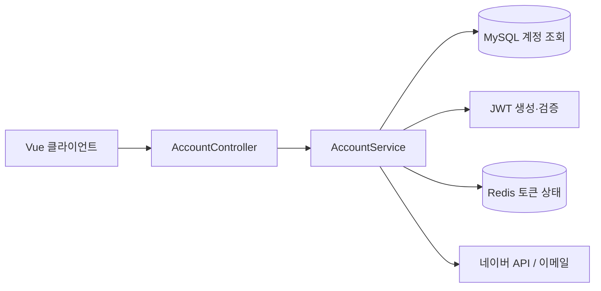

# CROFLE Backend — 회원과 인증 흐름

**일반 사용자와 판매자가 같은 인증 흐름을 사용하도록 계정 API를 구성하고, JWT·Redis·네이버 로그인을 연결했습니다.**

[전체 포트폴리오](../../README.md) · [본인 저장소](https://github.com/firstsm41/Live-CrowdFunding-Backend) · [팀 저장소](https://github.com/ssg-ic-project/Live-CrowdFunding-Backend) · [EdenKwon 참고 저장소](https://github.com/EdenKwon/Live-CrowdFunding-Backend) · [프론트엔드 담당 내용](../crofle/README.md)

| 항목 | 내용 |
|---|---|
| 유형 | CROFLE 팀 프로젝트의 백엔드 담당 내용 |
| 담당 | AAA — 회원가입·로그인·계정 복구·소셜 로그인 관련 구현 |
| 기술 | Java 17, Spring Boot 3.3.5, Spring Data JPA, MySQL, Redis, JWT, Spring Mail |
| 구현 시기 | 2024년 11월 회원·인증 변경 이력 확인 |

## 팀 전체와 개인 담당 범위

전체 백엔드는 펀딩 프로젝트·예약·주문·결제·대시보드·채팅 등을 포함합니다. 저는 회원과 로그인, 토큰 갱신·로그아웃, 계정 찾기·재설정, 네이버 로그인 영역을 중심으로 작업했습니다.

팀원의 프로젝트 심사·예약 락·결제 구현을 개인 성과로 포함하지 않았습니다. 프론트엔드와 같은 CROFLE 프로젝트를 서버 관점에서 설명하는 페이지입니다.

## 핵심 흐름

| 기능 | 코드에서 확인한 처리 |
|---|---|
| 공통 로그인 | `AccountView`로 계정 정보를 조회하고 비밀번호를 확인한 뒤 토큰 발급 |
| 토큰 갱신 | JWT 검증, Redis에 저장된 Refresh Token 비교, 실제 계정 확인 후 새 토큰 발급 |
| 로그아웃 | Redis에 저장된 해당 계정의 Access/Refresh Token 삭제 |
| 비밀번호 재설정 | 이메일 링크, 목적이 구분된 재설정 토큰, Redis 상태·만료 확인, 비밀번호 변경 |
| 소셜 로그인 | 네이버 인증 결과 조회와 서비스 계정 연결, 서비스 토큰 반환 |
| 사용자 유형 분리 | USER·MAKER 모델과 공통 계정 조회를 연결 |

## 구현하면서 다룬 것

### 사용자 유형이 달라도 로그인은 공통으로

일반 사용자와 판매자의 데이터는 나뉘지만 로그인 요청은 하나의 계정 흐름을 사용합니다. 읽기 전용 `AccountView`를 공통 조회 모델로 사용하고, 역할에 따라 실제 회원 모델에 변경을 반영하도록 구성했습니다.

### 토큰의 서명과 서버 상태를 함께 확인

토큰 갱신 시 JWT 형식·유효성만 확인하지 않고 Redis에 보관한 값과 비교합니다. 갱신 후에는 새 토큰을 저장하고, 로그아웃에서는 저장된 값을 제거하는 식으로 서버가 토큰 상태를 관리하도록 구현했습니다.

### 계정 복구도 토큰의 사용 상태를 다루기

재설정 토큰은 만료와 사용 상태를 검사하고, 변경이 끝나면 삭제하는 흐름을 구현했습니다. 다만 현재 코드에서는 검증 단계가 사용 상태도 바꾸므로, 사전 확인 요청과 실제 변경 요청이 충돌하지 않게 역할을 분리하는 보완이 필요합니다.

## 돌아보면

이번 코드는 인증 기능을 학습하고 통합한 결과물입니다. 운영에 적용한다면 자격정보가 로그에 남지 않도록 하고, 토큰 검증·소모의 원자성, 서버의 역할별 접근 제어, 클라이언트 저장 방식을 함께 점검해야 합니다. 기능 구현과 운영 보안 검증이 별개의 일이라는 점을 설명할 수 있는 프로젝트입니다.

## 코드와 개인 기여 근거

- [`AccountServiceImpl.java`](https://github.com/firstsm41/Live-CrowdFunding-Backend/blob/03a6e7f430031f1c2206e58b3e6cdbc0112b62b1/src/main/java/com/crofle/livecrowdfunding/service/serviceImpl/AccountServiceImpl.java): 로그인·갱신·복구·소셜 연결
- [`AccountView.java`](https://github.com/firstsm41/Live-CrowdFunding-Backend/blob/03a6e7f430031f1c2206e58b3e6cdbc0112b62b1/src/main/java/com/crofle/livecrowdfunding/domain/entity/AccountView.java): 공통 계정 조회 모델
- [네이버 로그인 구현](https://github.com/firstsm41/Live-CrowdFunding-Backend/commit/e0c59a58da4ec2b1d9cb4cb532ad80b52886b8af)
- [토큰 갱신 수정](https://github.com/firstsm41/Live-CrowdFunding-Backend/commit/a6b13e61c2b4c70818d790e77a43c019b51ba7c4)
- [계정 복구 기능 추가](https://github.com/firstsm41/Live-CrowdFunding-Backend/commit/0353de3eaae49e486d70a0f56a3339b1a6731b97)

관련 테스트 소스도 확인했지만 이번 포트폴리오 작성에서는 외부 인증·메일·운영 DB를 호출하는 실행 검증은 하지 않았습니다.
