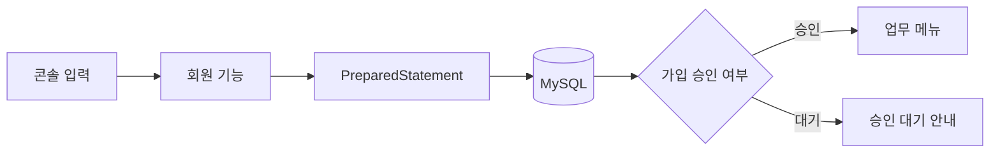

# Medicine WMS — 의약품 창고 관리 CLI

**일반회원·배송기사·관리자가 서로 다른 업무를 시작할 수 있도록 로그인과 회원관리를 구현한 Java 팀 프로젝트입니다.**

[전체 포트폴리오](../../README.md) · [소스 코드](https://github.com/firstsm41/medicine-wms)

| 항목 | 내용 |
|---|---|
| 유형 | 교육 과정 팀 프로젝트 · Java CLI |
| 담당 | 로그인, 회원가입·조회·수정, 계정 찾기·비밀번호 변경 |
| 기술 | Java, JDBC, MySQL, PreparedStatement |
| 구현 시기 | 2024년 8월 |

## 어떤 문제를 다뤘나

의약품 창고에서는 상품을 요청하는 일반회원, 물품을 운송하는 배송기사, 업무를 관리하는 관리자가 같은 시스템을 사용합니다. 회원 유형에 따라 필요한 정보가 다르고, 가입했다고 바로 업무를 시작해서도 안 됩니다.

저는 사용자가 회원 유형에 맞는 정보를 입력하고, 관리자 승인 이후에 업무 메뉴로 들어가는 진입 흐름을 맡았습니다.

## 내가 구현한 부분

| 기능 | 처리 방식 |
|---|---|
| 유형별 회원가입 | 공통 회원정보와 함께 사업장·차량·창고 정보를 회원 유형에 맞춰 입력 |
| 승인 상태를 확인하는 로그인 | 아이디·비밀번호 조회 후 승인 여부를 검사하고, 미승인 사용자는 안내 |
| 회원정보 조회·변경 | 회원 유형별 추가 정보를 보여주고, 수정 시 비워 둔 값은 기존 값 유지 |
| 아이디 찾기 | 이름·연락처 조합으로 계정 조회 |
| 비밀번호 변경 | 회원 식별정보를 확인한 뒤 비밀번호 변경 |

## 구현하면서 다룬 것

### 회원 유형별 데이터를 한 흐름에서 처리하기

가입 화면에서 일반회원·배송기사·관리자 유형을 고르면 필요한 추가 입력이 달라집니다. 공통 정보와 유형별 정보를 구분해 받고, 회원 조회·수정에서도 같은 구분을 적용했습니다. 같은 회원 테이블을 사용하면서도 사용자에게 필요한 항목을 다르게 보여주는 경험을 했습니다.

### 입력값과 SQL 실행 분리하기

회원 조회와 변경에는 `PreparedStatement`의 바인딩을 사용했습니다. 입력값을 SQL 문자열에 직접 이어 붙이지 않고, 회원 아이디와 변경할 값을 매개변수로 넘기도록 구성했습니다.

### 가입과 업무 이용을 분리하기

로그인 시 자격정보가 맞는지만 확인하지 않고 가입 승인 여부를 한 번 더 검사했습니다. 계정 생성과 실제 업무 진입을 구분하는 것이 이 기능의 중요한 조건이었습니다.

## 돌아보면

CLI 입력, 업무 처리, DB 접근이 일부 클래스에 함께 있어 테스트와 재사용이 쉽지 않습니다. 다시 만든다면 입력 계층과 회원 서비스를 분리하고, 비밀번호 해시 저장과 설정 외부화를 먼저 적용하겠습니다. 이 경험은 이후 Spring 기반 회원관리와 JWT 인증을 구현하는 출발점이 됐습니다.

## 코드 확인 근거

- [`memberServices.java`](https://github.com/firstsm41/medicine-wms/blob/715b4bc86a8c82e59b7b8495de3453de02617dcd/src/dao/memberServices.java): 가입·로그인·아이디 찾기·비밀번호 변경
- [`MemberCRUDImpl.java`](https://github.com/firstsm41/medicine-wms/blob/715b4bc86a8c82e59b7b8495de3453de02617dcd/src/services/MemberCRUDImpl.java): 회원정보 조회·수정
- [회원관리 기능 추가 커밋](https://github.com/firstsm41/medicine-wms/commit/88b93f25907c628930d456534f8f9a18a35994d8): `firstsm41` 작성 이력

팀 전체의 입고·출고·재고·재무 기능과 개인 담당 기능을 구분해 작성했습니다.
