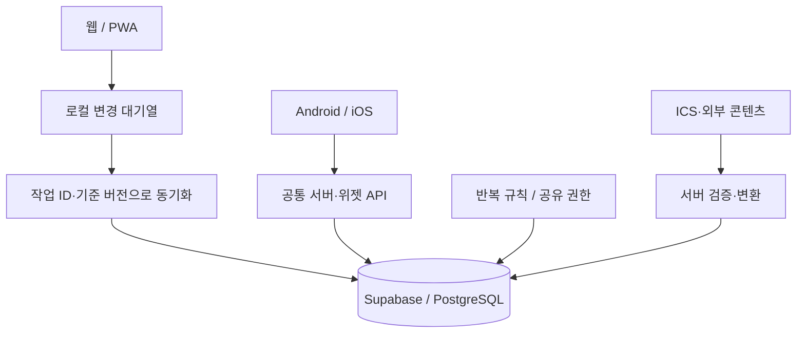

# 모아봄 — 함께 쓰는 일정과 기록장

**공유 캘린더에 일정·다녀온 장소·본 콘텐츠를 모으고, 연결이 끊겨도 변경을 이어갈 수 있게 만든 앱입니다.**

[전체 포트폴리오](../../README.md)

| 항목 | 내용 |
|---|---|
| 유형·담당 | 개인 개발 프로젝트 · 웹·데이터 모델과 모바일 클라이언트 구현 |
| 플랫폼 | Next.js 웹·PWA, Android·iOS 앱 및 위젯 코드 |
| 기술 | Next.js 16, React, TypeScript, Supabase, PostgreSQL, Kotlin, Swift |
| 코드 공개 | 비공개 — 실제 일정·장소·사진·사용자 데이터는 포함하지 않음 |

## 어떤 문제를 다루나

공유 일정과 다녀온 장소·본 영화의 기록이 따로 있으면 하루를 다시 보기 어렵습니다. 모아봄은 캘린더를 중심으로 계획과 기록을 함께 모으고, 누구와 무엇을 공유할지도 정할 수 있게 만든 서비스입니다.

서비스의 핵심은 일정 입력 화면만이 아니라 **반복 일정·공유 권한·여러 기기의 변경**을 일관되게 처리하는 데 있습니다.

## 주요 기능

- 개인·공유 캘린더와 초대, 편집·보기 역할 구분
- 월·주·다가오는 일정, 양력·음력 반복 일정과 회차별 편집
- 장소·영화 등 기록, 사진·별점·댓글·위시리스트
- 일정 후보 투표와 반복 회차별 참석 응답
- 오프라인 일정 변경 대기열과 연결 복구 후 동기화
- ICS 가져오기·내보내기·외부 캘린더 구독
- 웹 푸시, Android·iOS 앱과 홈 화면 위젯

## 설명하고 싶은 구현

### 반복 일정을 하나의 날짜 목록으로 다루지 않기

반복 규칙을 파싱하고 필요한 조회 구간에서 회차를 펼칩니다. 월말처럼 날짜가 없는 달, 여러 날에 걸친 일정, 음력 반복, 제외한 회차를 구분합니다. 웹·Android·iOS에서 같은 날짜·반복 입력에 같은 결과가 나오는지 확인할 수 있도록 공통 fixture와 플랫폼별 테스트가 포함돼 있습니다.

### 다시 전송해도 같은 변경을 두 번 적용하지 않기

오프라인 변경은 사용자별 대기열에 저장하고, 연결이 복구되면 작업 ID와 기준 버전을 함께 보냅니다. 서버는 이미 처리한 작업을 구분하고, 다른 사용자가 먼저 바꾼 경우에는 충돌로 반환합니다.

브라우저의 여러 탭이 동시에 전송하지 않도록 Web Locks를 사용하고, 사용할 수 없는 환경에서도 작업 ID를 통해 중복 적용을 제어합니다. 실패는 성공한 것처럼 지우지 않고 다시 확인할 수 있는 항목으로 남깁니다.

### 외부 캘린더 주소를 그대로 가져오지 않기

사용자가 등록한 구독 주소는 서버가 요청하게 됩니다. HTTPS·주소 범위·DNS 결과를 검사하고, 리다이렉트도 다시 검사하며, 응답 시간과 크기를 제한합니다. ICS 내용은 인코딩·시간대·반복 규칙을 해석해 앱의 일정으로 변환합니다.

### 위젯도 같은 일정 규칙으로

서버에서 일정과 D-day를 위젯용 데이터로 구성하고, 앱·위젯이 표시할 범위와 요청 형식을 정합니다. 네이티브 코드와 위젯 테스트는 저장소에 포함돼 있으며, 앱스토어 배포 여부나 실사용자 수를 이 문서의 성과로 주장하지 않습니다.

## 검증을 위한 구성

반복 일정, 오프라인 작업의 재전송·충돌·계정 분리, 위젯 날짜 범위, 외부 URL 요청 제한 등에 대한 테스트가 있습니다. 테스트 소스와 경계 조건을 확인했으며, 이번 문서 작업에서 웹·모바일 전 플랫폼 테스트나 운영 서버를 실행하지는 않았습니다.

## 코드 확인 범위

`lib/recur.ts`, `lib/outbox.ts`, `components/OutboxSync.tsx`, `lib/net/safe-fetch.ts`, `lib/ics-parse.ts`, `lib/widget.ts`, DB 동기화 마이그레이션, 공통 fixture와 웹·네이티브 테스트를 확인했습니다. 비공개 소스·인증 설정·실제 사용자의 기록은 공개하지 않습니다.
