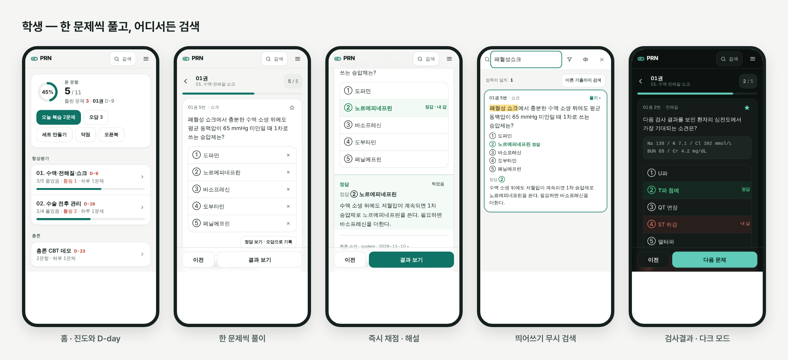
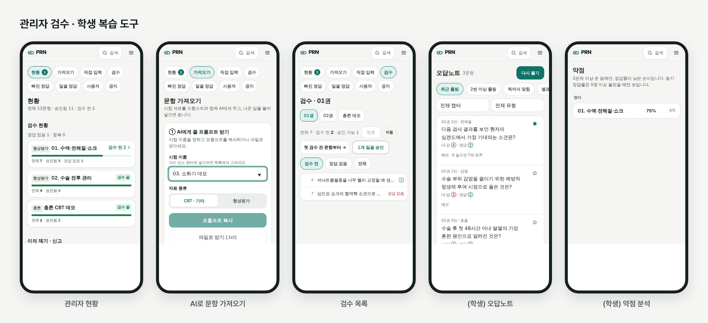
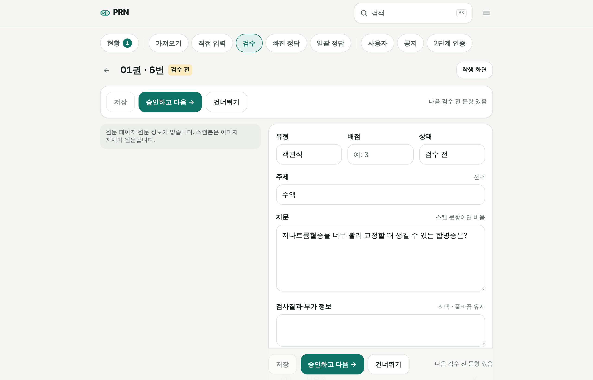
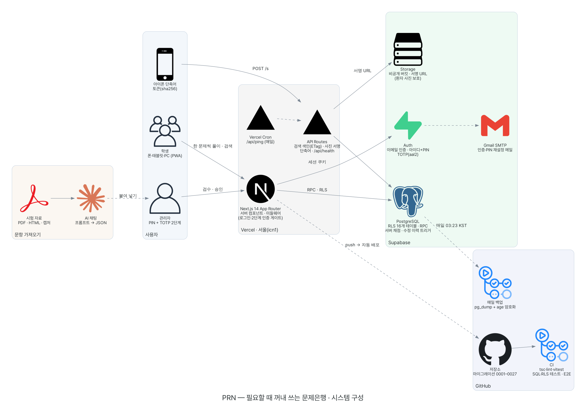
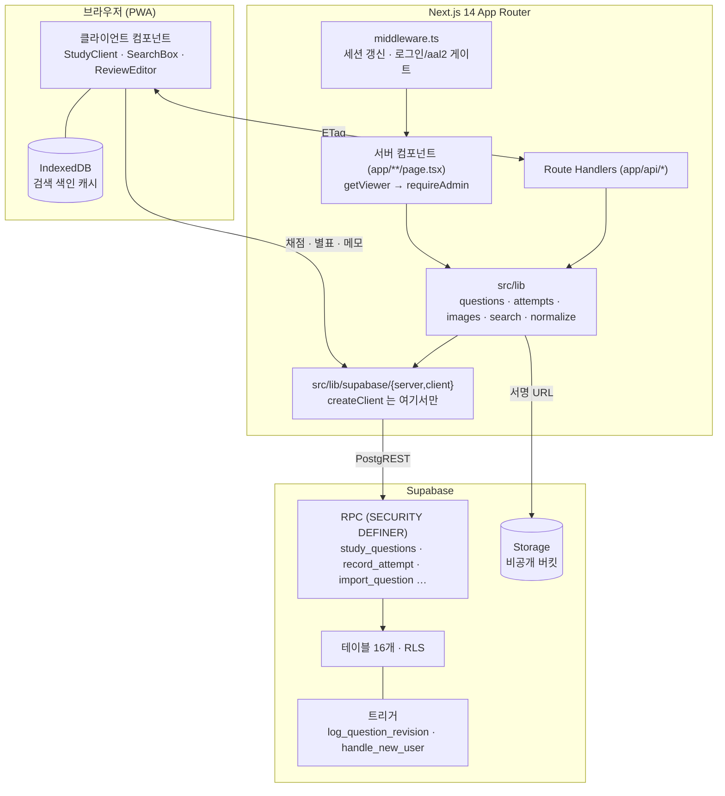
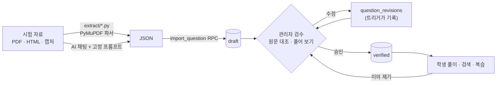
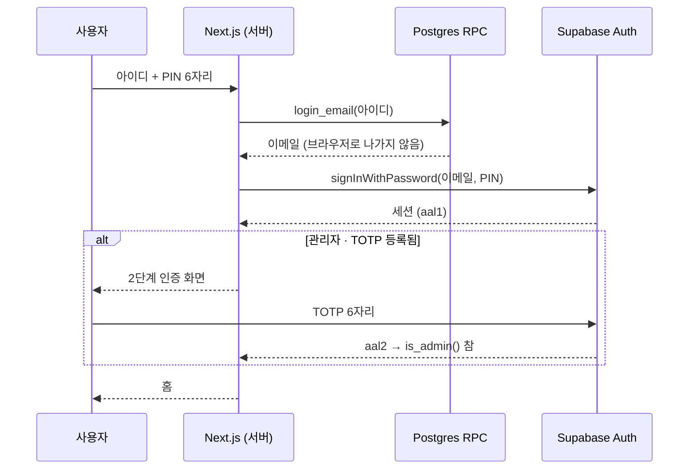
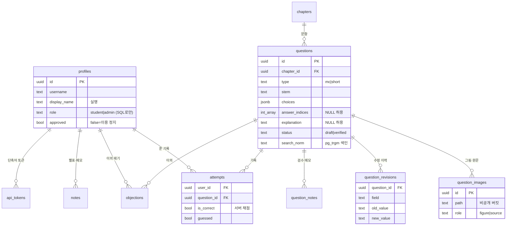

<div align="center">


# PRN

**필요할 때 꺼내 쓰는 문제은행**

<sub><i>PRN</i> (<i>pro re nata</i>) — 처방전에서 「필요할 때마다」를 뜻하는 의학 약어</sub>

외과 시험 문항 1,600여 개를 한 문제씩 풀고, 어디서든 바로 검색하고, 관리자가 검수해 올린다.


[발표 자료 PDF](PRN-portfolio.pdf) · [주요 기능](#-주요-기능) · [아키텍처](#-아키텍처) · [설계 결정](#-설계-결정) · [테스트](#-테스트) · [추후 개선](#-추후-개선) · [변경 이력](#-변경-이력)



<sub>스크린샷은 모두 직접 만든 데모 데이터로 찍었다. 문항은 교과서 수준 일반 지식으로 새로 쓴 예시이고 계정도 가짜다.</sub>

</div>

---

## 📖 소개

외과 시험 자료는 형성평가 스캔본, CBT 복원 해설 PDF, 시험 사이트 HTML, 엑셀 정답표로 흩어져 있었다.
폰으로 찾아보기 어려웠고, 정답이 틀려도 누가 언제 고쳤는지 남지 않았다.

이름처럼, 시험 전 몰아 보는 문제집이 아니라 **궁금할 때 바로 꺼내 보는** 도구를 목표로 했다.
수업 중에 떠오른 개념을 폰에서 검색하면 그 자리에서 기출과 정답·해설이 보이고, 짬이 날 때 한 문제씩 푼다.

PRN 은 흩어진 자료를 파싱해 한 DB 에 모으고 세 가지를 한다.

| | |
|---|---|
| **풀기** | 한 화면에 문항 하나. 답을 고르면 서버가 채점하고, 정답과 해설을 보여 준 뒤 다음 문제로 간다 |
| **찾기** | 모든 화면 우상단에 검색창이 있다. 결과 카드 안에서 정답과 해설을 바로 본다 |
| **검수** | 가져온 문항은 모두 `draft` 로 들어간다. 관리자가 원문과 대조해 승인한 `verified` 만 학생에게 보인다 |

| 지표 | 값 |
|---|---|
| 문항 · 챕터 | 1,600여 개 · 20개 (형성평가 12권 · 총론/각론 CBT) |
| 정답 · 해설 채움 | 약 99% · 약 95% |
| DB | 테이블 16개 모두 RLS · 마이그레이션 27개 (모두 멱등) |
| 테스트 | 단위 118개 · SQL 실행 테스트 · 브라우저 E2E — PR 마다 CI |
| 기간 | 2026-09 ~ 2026-11 · 버전 1.x → 2.6 |

---

## ✨ 주요 기능

### 학생

- **한 문제씩 풀이** — 객관식은 고르면 바로 채점, 서술형은 정규화 일치와 동의어로 채점하고 안 맞으면 본인이 판정한다
- **오답노트** — 최근 틀림 · 2번 이상 틀림 · 찍어서 맞힘 · 별표. 다시 맞혀도 누적 기록은 남는다
- **오늘의 복습** — 연속 정답 수에 따라 1·3·7·14일 뒤 다시 낸다. 흔들린 문항은 시험 전날까지 당긴다
- **맞춤 세트 · 약점 분석** — 여러 챕터를 섞어 N문제, 주제·챕터별 내 정답률과 동기 정답률
- **동기 선지 비율 · 반복 출제 · 비슷한 문제** — 채점 뒤 보기별 선택 비율, 같은 문항이 나온 횟수, 틀린 문제와 닮은 문항
- **정답 준비 중** — 정답이 아직 없는 문항도 숨기지 않고 보여 준다. 채점만 건너뛴다
- **PWA · 다크 모드 · 아이폰 단축어** — 홈 화면에 설치하고, 액션 버튼 한 번으로 다른 앱에서 검색한다

### 관리자

- **AI 가져오기** — 시험 자료와 고정 프롬프트를 AI 채팅에 주고, 나온 JSON 을 붙여 넣는다. 미리보기 뒤 draft 로 저장
- **검수 편집기** — 원문 페이지 대조, 사진 잘라내기, 검수 메모, 수정 이력과 되돌리기, `승인하고 다음`
- **풀면서 검토** — 원문 정답을 가린 채 학생처럼 풀어 본 뒤 승인한다
- **일괄 작업** — TSV 일괄 정답, 일괄 승인. 둘 다 묶음 단위로 되돌릴 수 있다
- **현황** — 실시간 접속자, 일별 활동, 정답 의심 문항(동기 절반 이상이 다른 답을 고른 문항), 이의 제기와 답변

<div align="center">


</div>

---

## 🏗 아키텍처

### 시스템 구성



| 구성 요소 | 역할 |
|---|---|
| **Next.js (Vercel 서울)** | 서버 컴포넌트가 화면 데이터를 RPC 로 가져온다. 미들웨어는 세션 갱신과 로그인·2단계 인증 확인만 한다 |
| **API Routes** | 검색 색인(ETag/304), 사진 서명 URL, 아이폰 단축어, 상태 진단(`/api/health`), 재우기 방지 핑(Vercel Cron) |
| **Supabase Postgres** | 권한 판단을 맡는다. RLS, `SECURITY DEFINER` RPC, 서버 채점, 수정 이력 트리거 |
| **Supabase Auth · Storage** | 이메일 인증, 아이디+PIN 로그인, 관리자 TOTP. 사진은 비공개 버킷에 두고 서명 URL 로만 준다 |
| **GitHub Actions** | CI(타입·린트·단위·SQL·E2E), 매일 암호화 백업 |

### 애플리케이션 레이어



- **데이터는 서버에서 가져온다.** 화면 데이터는 서버 컴포넌트가 RPC 로 한 번에 받는다. 클라이언트는 채점·별표 같은 쓰기만 한다.
- **권한은 DB 가 판단한다.** 앱 코드에 버그가 있어도 RLS 가 막는다. 예를 들어 학생 세션으로는 draft 문항이나 원문 페이지를 읽을 수 없다.
- **경계 규칙** — `createClient` 는 `src/lib/supabase/` 에서만 부르고, `select("*")` 는 쓰지 않으며, 타입은 `src/lib/types.ts` 한 곳에 둔다.

### 문항 파이프라인



### 인증 흐름



### 데이터 모델



<sub>그 밖에 <code>events</code> · <code>announcements</code> · <code>feedback</code> · <code>client_errors</code> · <code>keepalive</code> · <code>schema_migrations</code>.</sub>

### 디렉터리 구조

```
.
├── src/
│   ├── app/                  # App Router
│   │   ├── (auth)/           #   로그인 · 가입
│   │   ├── study/[chapterId] #   한 문제씩 풀이
│   │   ├── q/[id]            #   문항 단독 보기
│   │   ├── review · set · weak · openbook
│   │   ├── admin/            #   현황 · 가져오기 · 검수 큐 · 편집기 · 사용자
│   │   └── api/              #   search-index · q/[id]/images · shortcut · health · ping
│   ├── components/           # ui 프리미티브, TopBar(고정 검색창), study/ search/ admin/
│   ├── lib/                  # 도메인 로직과 테스트(*.test.ts)
│   │   ├── supabase/         #   클라이언트 생성은 여기서만
│   │   ├── search/           #   색인 · 질의 · IndexedDB · 유사도
│   │   └── normalize.ts      #   ≡ SQL normalize_kr()
│   └── middleware.ts         # src/ 안에 있어야 Next 가 읽는다 (CI 가 검사)
├── supabase/
│   ├── migrations/           # 0001–0027, 모두 멱등
│   ├── tests/                # SQL 실행 테스트 (RLS · RPC · 트리거)
│   └── templates/            # 인증·PIN 재설정 메일
├── extract/                  # 시험 자료 파서 (Python · PyMuPDF)
├── tools/
│   ├── local-harness/        # 가짜 Supabase 게이트웨이 + Playwright E2E
│   └── gen-normalize-table.mjs
├── docs/                     # 명세 · 파이프라인 · 구성도 · 스크린샷
└── public/                   # PWA manifest · 서비스 워커 · 아이콘
```

---

## 🧭 설계 결정

### 1. 한국어 검색: 형태소 분석 대신 정규화

Postgres 에는 한국어 형태소 분석기가 없어서 `to_tsvector` 를 쓰지 않았다. 대신 글자와 숫자만 남기고 소문자로 바꾼 `search_norm` 열을 만들고 `pg_trgm` 색인을 걸었다.
`패혈성 쇼크`, `패혈성쇼크`, `①패혈성-쇼크` 는 모두 같은 문자열이 된다.

같은 규칙이 SQL `normalize_kr()` 과 브라우저 색인(`normalize.ts`) 두 곳에 있다. 그런데 Postgres 의 `[[:punct:]]` 는 glibc 로캘 표를, JS 의 `\p{P}` 는 유니코드 표를 따라서 **1,800여 글자에서 결과가 달랐다.**
생성기(`gen-normalize-table.mjs`) 는 Postgres 에 모든 코드 포인트를 넣어 보고, 차이를 예외 표로 만든다. 이 표를 쓰면 두 구현이 전 유니코드에서 같은 결과를 낸다.

### 2. 보안: 앱이 아니라 DB 가 지킨다

| 위협 | 대응 |
|---|---|
| 학생이 검수 전 문항이나 원문(정답 표시) 보기 | RLS — 학생은 `verified` 만, 원문 페이지(`role='source'`)는 관리자만 |
| 환자 사진 유출 | Storage 버킷 비공개, 짧은 서명 URL 만. 원본 자료는 저장소에 커밋하지 않는다 |
| 관리자 PIN 유출 | TOTP 2단계 인증. `is_admin()` 이 aal2 를 요구한다 |
| 클라이언트 조작으로 정답률 부풀리기 | 서버 채점(`record_attempt`) — 앱이 `is_correct` 를 정하지 않는다 |
| 단축어 토큰 유출 | sha256 해시만 저장, 기기 고정, 5개 상한, 이용 정지하면 즉시 폐기 |
| 열린 가입으로 무료 DB 채우기 | 글 길이 제한, 이벤트 하루 200건, 정지 계정은 쓰기 불가 |
| 역할 상승 | `profiles.role` 은 SQL 로만 바꾼다 |
| 비밀 키 노출 | 앱에는 공개 키만 둔다. 서비스 키는 로컬 추출 스크립트에서만 쓴다 |

### 3. 사람이 고친 것을 기계가 덮지 않는다

반입 스크립트를 다시 돌려도 사람이 고친 verified 문항은 건너뛴다. 일괄 승인과 일괄 정답은 묶음으로 기록해 한 번에 되돌릴 수 있다.
정답·해설 수정 이력은 앱이 아니라 트리거 `log_question_revision` 이 남긴다. 그래서 앱에 버그가 있어도 이력이 빠지지 않는다.

### 4. Supabase 없이도 끝까지 테스트한다

로컬 하네스(`tools/local-harness`) 는 Postgres, PostgREST, Node 로 만든 가짜 Auth/Storage 게이트웨이(약 200줄)로 Supabase 를 흉내 낸다.
실제 마이그레이션과 RLS 위에서 Playwright 가 학생·관리자 흐름 전체를 밟는다. 이 README 의 스크린샷도 이 하네스로 찍었다.

---

## 🧪 테스트

```bash
npm run check      # tsc + eslint + vitest (단위 118개)
npm run test:sql   # 빈 Postgres 에 마이그레이션 전부를 두 번 적용(멱등 확인) + RLS·RPC·트리거 테스트
npm run build
npm run e2e:ci     # 로컬 하네스 브라우저 E2E
```

GitHub Actions 는 PR 마다 위 넷을 모두 돌리고, `middleware.ts` 가 실제로 등록됐는지도 확인한다.

---

## ⚙️ 운영

| | |
|---|---|
| **백업** | 매일 03:23 KST `pg_dump` → `age` 공개키로 암호화 → Actions 아티팩트. 개인키는 저장소 밖에만 둔다. 복원 연습 완료 |
| **재우기 방지** | 무료 플랜은 일주일 동안 활동이 없으면 잠든다. Vercel Cron 이 매일 `/api/ping` 을 불러 실제로 한 행을 쓴다(읽기만 하는 핑으로는 잠든 적이 있다) |
| **자가 진단** | `/api/health` 가 키 종류, 서버 연결, 마이그레이션 버전을 한국어로 알려 준다 |
| **롤백** | 앱은 Vercel Instant Rollback, DB 는 새 마이그레이션으로만 |

---

## 🗺 추후 개선

기능은 완성 상태다. 운영하면서 정리해 둔 개선 거리는 다음과 같다.

**백업**
- [ ] DB 백업을 매일에서 주 1회로 줄인다. 문항은 더 늘지 않고 바뀌는 건 풀이 기록 정도라 주 1회면 충분하다. 큰 수정 전에는 수동 실행(`workflow_dispatch`)
- [ ] Storage(문항 사진·원문 페이지) 백업. `pg_dump` 는 DB 만 담는다. 원본 PDF 에서 다시 뽑을 수 있지만, 관리자가 웹에서 잘라 올린 사진은 다시 만들 수 없다
- [ ] Supabase 무료 플랜에는 관리형 백업이 없다. 사용자가 늘면 Pro(7일 자동 백업·대시보드 복원)를 검토한다

**보안**
- [ ] 관리자 계정에 TOTP 를 등록하고, `is_admin()` 이 등록 여부와 관계없이 항상 aal2 를 요구하게 한다
- [ ] Supabase Auth 에 CAPTCHA 와 로그인 시도 제한을 둔다 — 가입이 열려 있다
- [ ] 저장소를 공개하면 `SECURITY.md`(취약점 제보 경로)를 둔다

**의존성**
- [ ] Next.js 15+ 로 올린다. 남은 보안 권고는 대부분 메이저 업그레이드로만 풀리고, 이 앱이 쓰지 않는 기능(이미지 최적화 원격 패턴·rewrites 등)에 대한 것이라 지금은 14.2 를 유지한다

---

## 📝 변경 이력

| 버전 | 날짜 | 내용 |
|---|---|---|
| **2.6** | 2026-11-10 | 최종 점검 — 보안 손질(0027), 검색 정규화를 전 유니코드에서 일치, 채점·가져오기 버그 수정, 포트폴리오 문서 |
| **2.5** | 2026-10-28 | 출시 준비 — 관리자 2단계 인증, 열린 가입 + 실명, 매일 암호화 백업, 검수 보호, 서버 채점, CI 브라우저 E2E, 디자인 전면 개편 |
| 2.4 | 2026-10-25 | 학습 기능 — 맞춤 세트, 오늘의 복습, 찍었음, 동기 선지 비율, 반복 출제, 비슷한 문제, 약점 |
| 2.3 | 2026-10-25 | 성능 — 화면마다 Auth 왕복 줄임, 가벼운 검색 색인 · SQL 실행 테스트 |
| 2.2 | 2026-10-25 | 재우기 방지, 6명 검수 반영(보안·접근성·폰 흐름) |
| 2.1 | 2026-09-06 | 반입 파이프라인(원문 페이지·사진 잘라내기), 검수 메모, 실시간 접속자, 아이폰 단축어 |
| **2.0** | 2026-09-05 | 재작성 — 아이디+PIN 로그인, 텍스트 문항, RPC 로더, 검색 색인, 검수 도구, CI |
| 1.x | 2026-09-02 | 형성평가 스캔본 142문항, 검색·오답노트 초판 |

마이그레이션 파일 머리 주석에 변경마다 그 이유를 적어 두었다.

<details>
<summary>마이그레이션 목록</summary>

| | |
|---|---|
| `0001` | 스키마 전체 · RLS · RPC · 트리거 |
| `0002`–`0004` | 원문 페이지(`question_images.role`), 관리자 웹 반입 RPC |
| `0005`–`0006` | 검수 메모, 풀이 정렬 복구 |
| `0007` | 접속·학습 현황 |
| `0008`–`0012` | 단축어 토큰과 검색 |
| `0013` | 재우기 방지 심장박동 |
| `0014` | 검수 반영 — 단축어 기기 고정, 이력 이메일 감춤 |
| `0015` | 성능 — `my_profile`, 가벼운 검색 색인, RLS initplan |
| `0016` | 학습 기능 — 찍었음, 오늘의 복습, 맞춤 세트, 동기 선지 비율, 약점 |
| `0017`–`0018` | 단축어 토큰 접두사, 오픈북·단축어 허용제 |
| `0019` | 관리자 2단계 인증(TOTP) |
| `0020` | 마이그레이션 버전 기록, 화면 오류 수집 |
| `0021` | 검수 보호 — 재반입이 사람 손질을 덮지 않음, 일괄 작업 되돌리기 |
| `0022` | 진도에 「정답 준비 중」 수 |
| `0023` | 탈퇴·공지·신고·사용 이벤트·일별 KPI |
| `0024` | 서버 채점, 앱 의견 |
| `0025` | 관리자 계정 삭제 |
| `0026` | 열린 가입 + 실명 |
| `0027` | 출시 전 보안 점검 |

</details>

---

---

<sub>소스 코드는 비공개 저장소에 있습니다. 코드 열람이 필요하면 연락 주세요 — firstsm41@naver.com</sub>
