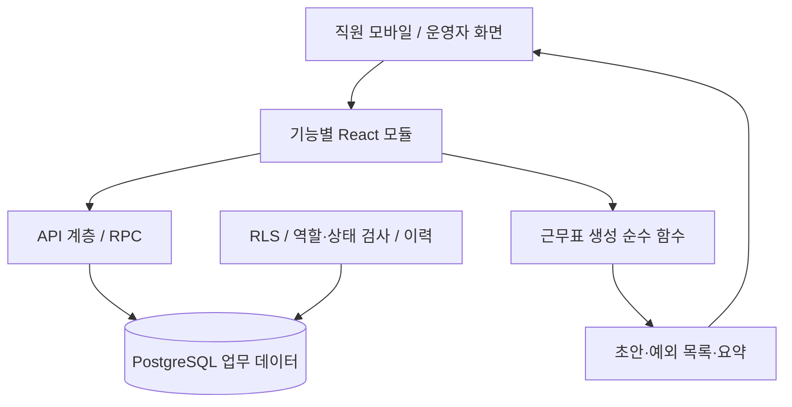

# 리쥬베리 워크스페이스 — 병원 운영 업무를 한곳에서

**근무표·연차·오버타임·인사 업무를 연결하고, 재고·마케팅·병원 TV 관리까지 확장한 운영 도구입니다.**

[전체 포트폴리오](../../README.md) · [스마트월 상세 사례](../smartwall/README.md)

| 항목 | 내용 |
|---|---|
| 유형·담당 | 개인 개발 프로젝트 · 기획, 웹 화면, 데이터 모델·권한, 운영 기능 확장 |
| 주요 사용자 | 운영자와 직원 |
| 기술 | React 19, TypeScript, Vite, Tailwind CSS, TanStack Query, Zustand, Supabase |
| 코드 공개 | 비공개 — 원본 코드와 실제 직원·운영 데이터는 이 문서에 포함하지 않음 |

## 어떤 문제를 다루나

근무표를 바꾸면 연차·오버타임·마감 숫자도 함께 영향을 받습니다. 운영자는 전체 상황을 확인하고 승인해야 하고, 직원은 휴대폰에서 자신의 일정과 신청 상태를 알아야 합니다.

이 프로젝트에서는 각각의 화면을 만드는 것에 더해 **신청 → 승인 → 근무표 반영 → 마감 → 정정 확인**이 연결되도록 업무 흐름을 구성했습니다.

## 주요 기능

| 영역 | 내용 |
|---|---|
| 근무표 | 월간 편집, 희망 오프·근무 교환, 조건을 고려한 자동 생성 초안 |
| 연차·오버타임 | 직원 신청, 운영자 승인, 사용·적립 현황과 근무표 연결 |
| 인사·권한 | 초대 기반 가입, 역할별 화면·데이터 접근, 개인정보 조회 범위 분리 |
| 마감 | 월별 보고 값과 마감 이후 변경 이력 확인 |
| 확장 모듈 | 재고·입출고·실사, 마케팅 조회, 스마트월 관리 |

## 설명하고 싶은 구현

### 규칙이 충돌할 수 있는 자동 근무표

희망 오프, 기존에 정해진 근무, 전월에서 이어지는 연속 근무, 팀별 필요 인원과 공평성은 서로 충돌할 수 있습니다. 생성기는 DB와 화면에 의존하지 않는 순수 함수로 두고, 새로 채울 칸과 함께 예외 목록·일별 인원·오프 요약을 반환합니다.

자동 생성 결과를 곧바로 확정된 정답으로 취급하지 않고 운영자가 예외를 확인할 수 있는 초안으로 다룹니다. 기존 입력을 보존하는 조건과 우선순위가 코드·테스트에 함께 남아 있습니다.

### 화면에서 숨기는 것과 조회를 막는 것 구분

연락처·생년월일 같은 정보는 일반 목록에 필요한 데이터와 구분합니다. 일반 화면은 필요한 컬럼만 조회하고, 관리용 조회는 별도 API·DB 권한을 거치게 구성했습니다. 사용자가 브라우저 화면을 우회하더라도 서버의 역할·상태 검사에 맞춰 처리하도록 설계했습니다.

### 마감 이후의 변경도 설명할 수 있게

월별 마감값과 그 이후의 정정을 구분합니다. 운영자가 마감 이후에 무엇을 바꿨는지 확인할 수 있게 변경 이력을 조회하고, 이전 마감값과 새 수정 사이의 관계를 보여줍니다. 단순히 편집 버튼을 막는 것보다 실제 운영 흐름에 가까운 모델을 다뤘습니다.

### 여러 도구를 한 코드베이스에서 운영하기

HR·재고·마케팅·스마트월의 화면·API 경계를 나누고 필요한 경로에서만 기능을 불러옵니다. 엑셀·이미지 내보내기처럼 무거운 기능은 사용할 때 가져오도록 구성했습니다. 스마트월의 내부망 TV 제어와 영상 처리는 [별도 사례](../smartwall/README.md)로 정리했습니다.

## 검증을 위한 구성

- 근무표 생성·날짜·예외 처리의 단위 테스트
- DB 마이그레이션과 RLS 회귀 점검 SQL
- 로컬 DB에서 마이그레이션 적용·재실행을 확인하는 검증 스크립트
- 운영 데이터 대신 가짜 데이터로 확인할 수 있는 테스트 구성

이번 문서는 소스와 테스트의 구조를 확인해 작성했으며, 운영 DB 실행이나 전 테스트 통과를 새로 검증한 결과를 뜻하지 않습니다.

## 코드 확인 범위

`src/features/schedule/generator.ts`, `src/api/employees.ts`, `src/api/closing.ts`, 기능별 화면·API, 관련 DB 마이그레이션과 테스트를 확인했습니다. 구체적인 직원 정보·내부 주소·접속 설정과 조직별 운영 기준값은 공개하지 않습니다.
