<div align="center">


# 스마트월

**병원 대기실 TV 9대를 브라우저 하나로**

삼성 세로형 사이니지 TV 에 사진과 영상을 돌린다. 전원, 예약, 상태까지 웹 관리 화면 하나에서 다룬다.


[발표 자료 PDF](SmartWall-portfolio.pdf) · [주요 기능](#-주요-기능) · [아키텍처](#-아키텍처) · [설계 결정](#-설계-결정) · [현장 문제 해결](#-현장-문제-해결) · [테스트](#-테스트) · [추후 개선](#-추후-개선) · [변경 이력](#-변경-이력)

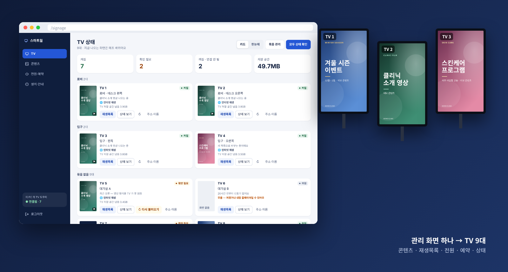

<sub>스크린샷은 모두 직접 만든 데모 데이터로 찍었다. TV 이름, 콘텐츠, 주소는 실제와 다르다.</sub>

</div>

---

## 📖 소개

한 피부과 의원의 대기실과 복도에 삼성 세로형 사이니지 TV 9대가 있었다. 이 TV 들은 다루기가 번거로웠다.

- 내장 플레이어에서 콘텐츠를 바꾸려면 TV 마다 USB 를 꽂아야 했다.
- 켜고 끄기와 입력 바꾸기는 MDC 명령어를 직접 쳐야 했다.
- TV 가 꺼지거나 화면이 멈춰도 데스크에서는 알 수 없었다.
- 제조사의 사이니지 관리 솔루션은 라이선스 비용이 든다.

스마트월은 TV 의 웹 브라우저, 병원이 이미 쓰던 클라우드(Supabase·Vercel), 병원 PC 한 대로 이 문제를 푼다. 별도 라이선스는 없다.
병원 사내 앱(근무·연차·인사)에 붙인 한 모듈이고, 4일 동안 PR 28개로 만들었다. 실제 TV 에 붙여 나온 문제를 그대로 고쳐 나갔다.

| | |
|---|---|
| **본다** | TV 9대가 켜졌는지, 지금 무엇이 나오는지, 파일을 받아 뒀는지, 남은 저장 공간과 받는 속도가 얼마인지 |
| **바꾼다** | 사진·영상 올리기, 폴더, TV 별·묶음별 재생목록, 게시 기간 |
| **다룬다** | 화면·전원 끄고 켜기, 인터넷 재생과 내장 플레이어 전환, 매일 켜고 끄는 예약, 새 TV 처음 설정 |
| **알린다** | 알림 시간 안에 TV 신호가 N분 넘게 없으면 관리자 휴대폰으로 웹 푸시 |

| 지표 | 값 |
|---|---|
| TV | 삼성 세로형 사이니지 9대 (Tizen 7 브라우저) |
| 프로그램 | 3개 — 관리 화면(React) · TV 재생 페이지(React 없음) · 병원 PC 도우미(Python) |
| 업로드 최적화 | 4K 영상 5개를 같은 기준으로 줄이면 208.7MB → 59.7MB (−71%) |
| DB | 마이그레이션 7개 (모두 멱등) · 표는 직접 못 읽고 RPC 로만 |
| 테스트 | 단위 49개 (재생·업로드 판단, MDC 대상, 설치 파일) · SQL 회귀 · 가짜 네트워크 브라우저 재현 |
| 기간 | 2026-11-06 ~ 11-09 · PR 28개 · 도우미 버전 1 → 7 |

---

## ✨ 주요 기능

### 상태 보기

- **TV 상태** — 켜짐, 확인 필요, 꺼짐 요약. TV 마다 지금 나오는 콘텐츠, 재생 방식(인터넷 재생/내장 플레이어), 남은 저장 공간이 보인다.
- **한눈에** — 묶음별로 세로 화면을 나란히 놓아 지금 나오는 것을 매초 보여 준다.
- **상태 보기** — TV 가 1분마다 보낸 값(받아 둔 파일, 저장 공간, 받는 속도, 최근 기록)과, 도우미가 읽은 TV 본체 상태(전원, 화면, 입력, 볼륨)를 함께 보여 준다.
- **재생목록** — 지금 나오는 줄을 표시한다. 항목마다 TV 에 받아 뒀는지, 인터넷으로 트는 중인지, 게시 기간이 언제인지 보인다.

<div align="center">
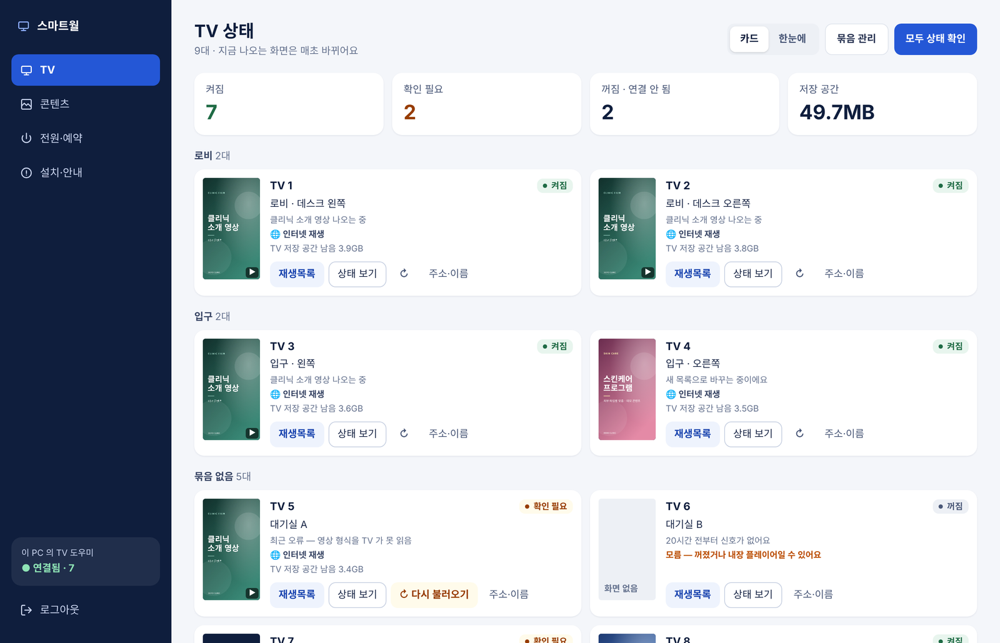
<br/>
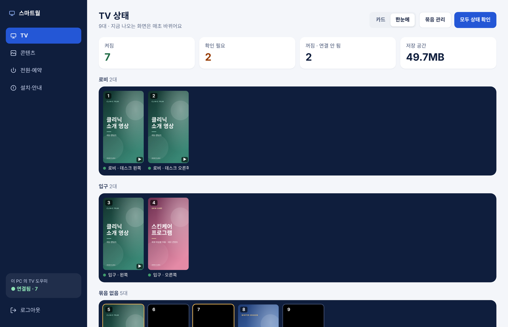
<br/>
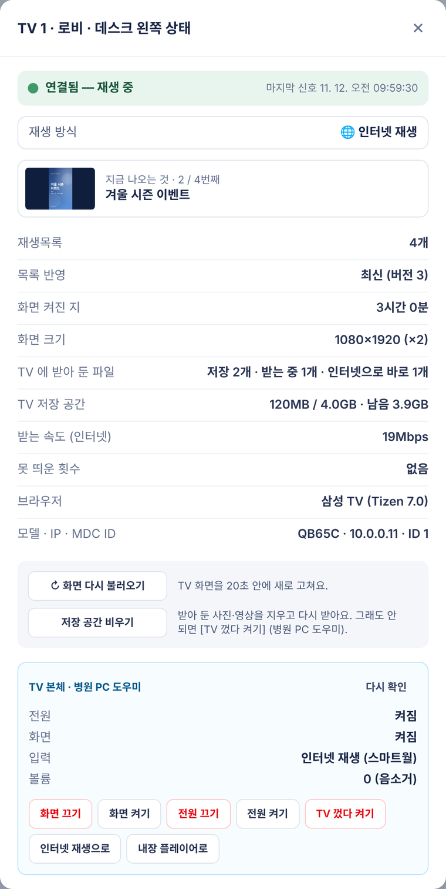
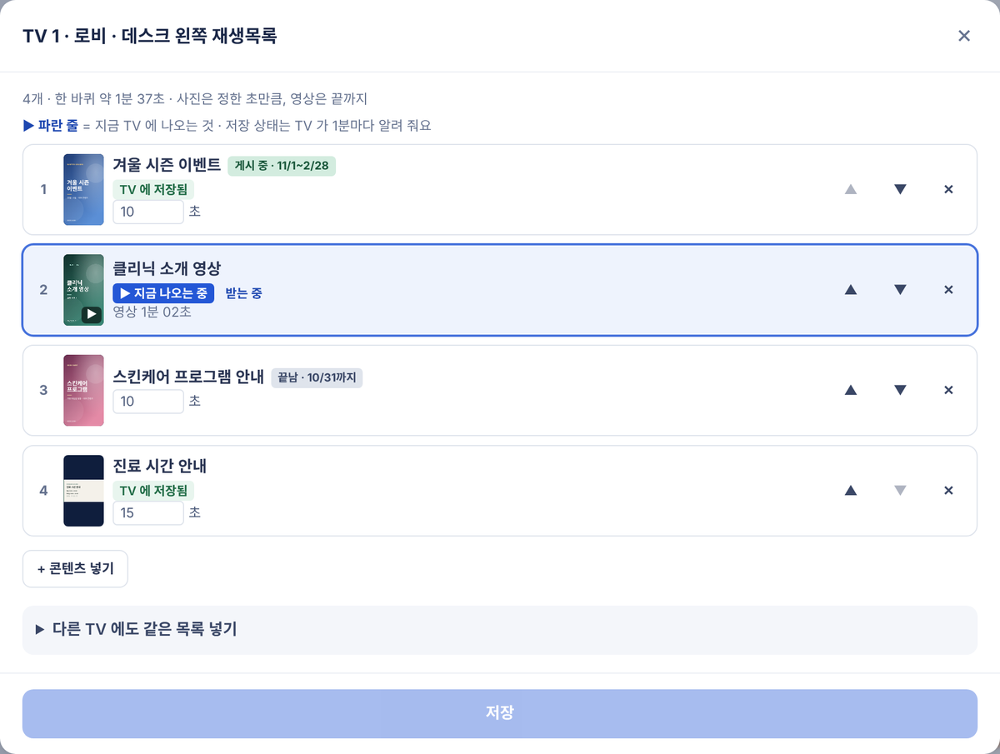
</div>

### 콘텐츠와 운영

- **콘텐츠 저장소** — 내 컴퓨터처럼 저장소에서 시작해 폴더로 들어간다. PC 에서는 끌어 놓아 옮긴다. 게시 기간을 정할 수 있고, 어느 TV 에 들어 있는지 보이고, 안 쓰는 파일을 정리할 수 있다.
- **올릴 때 최적화** — 4K 사진과 영상을 올리면 그 PC 의 브라우저에서 TV 에 맞게 다시 만들고, 검증한 뒤 올린다 ([설계 결정 3](#3-올리는-순간-브라우저가-다시-만든다)).
- **전원·예약** — TV 를 하나씩, 묶음으로, 또는 전체로 골라 화면이나 전원을 끄고 켠다. 재생 방식을 바꾸고, TV 껐다 켜기, 매일 켜고 끄는 예약(TV 본체 타이머)을 넣는다.
- **처음 설정 한 번에** — 새 TV 를 달면 원격 켜기 허용, 정전 뒤 자동 켜짐, 시계 맞추기, 인터넷 재생을 차례로 맞춘다.
- **TV 꺼짐 알림** — pg_cron 이 5분마다 확인하고, Edge Function 이 웹 푸시를 보낸다. 한 번 꺼질 때 한 번만 알린다.
- **휴대폰에서도** — 같은 화면이 폰 폭에 맞춰진다.

<div align="center">
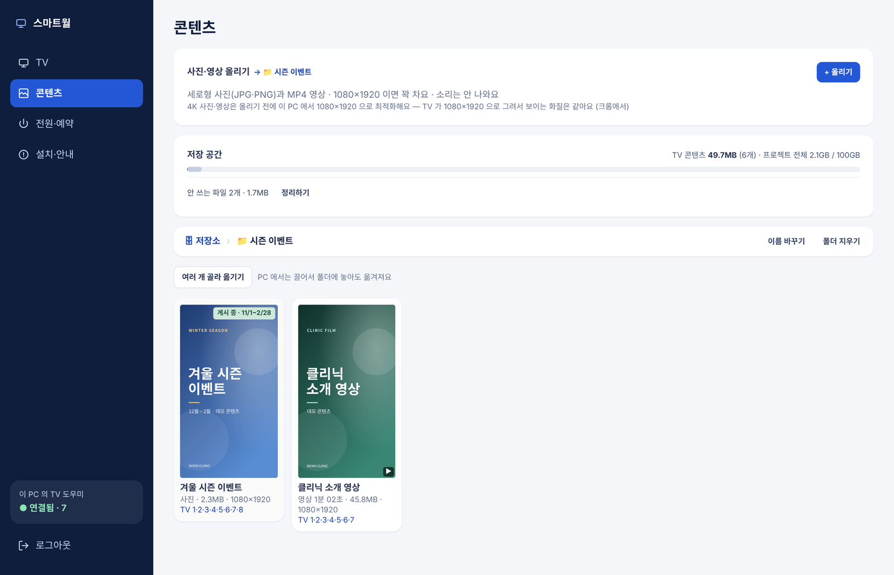
<br/>
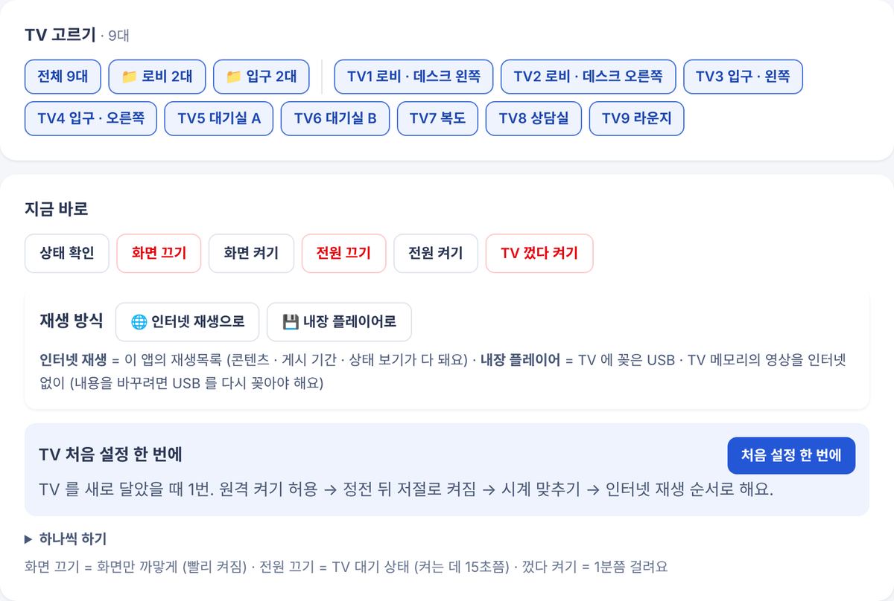
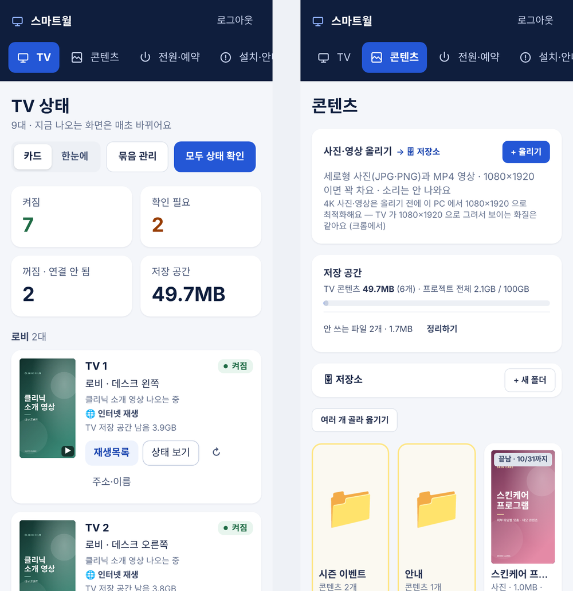
</div>

---

## 🏗 아키텍처

### 시스템 구성

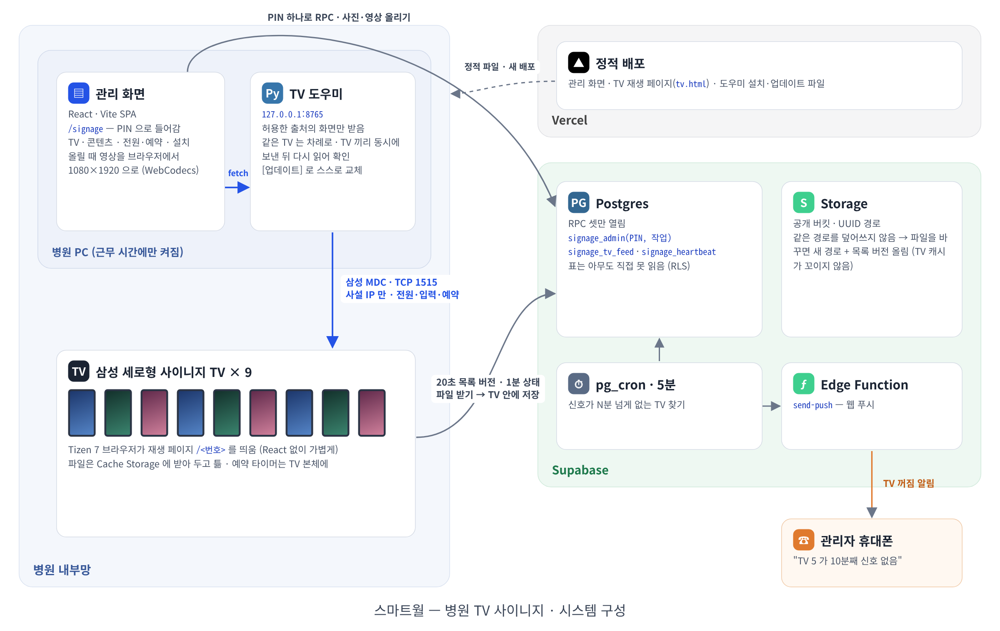

| 구성 요소 | 역할 |
|---|---|
| **관리 화면** (React · Vite) | 운영자는 인사 로그인 없이 PIN 으로 들어간다. 모든 작업은 RPC `signage_admin(PIN, 작업, 값)` 한 함수로 한다. 영상은 올리기 전에 브라우저에서 다시 만든다 |
| **TV 재생 페이지** (TypeScript, React 없음) | TV 의 Tizen 7 브라우저가 `/<번호>` 를 띄운다. 파일은 Cache Storage 에 받아 두고 튼다. 재생목록 버전은 20초마다 확인하고, 상태는 1분마다 보낸다 |
| **병원 PC 도우미** (Python) | `127.0.0.1:8765`. 그 PC 에서 연 관리 화면만 부를 수 있다. 삼성 MDC(TCP 1515)로 TV 본체를 다룬다 |
| **Supabase** | Postgres(RPC 셋, 모든 표 잠금), Storage(공개 버킷, UUID 경로), pg_cron(꺼짐 확인), Edge Function(웹 푸시) |
| **Vercel** | 관리 화면, 재생 페이지(`tv.html`), 도우미 설치·업데이트 파일을 배포한다 |

### TV 재생 — 한 항목을 띄우기까지

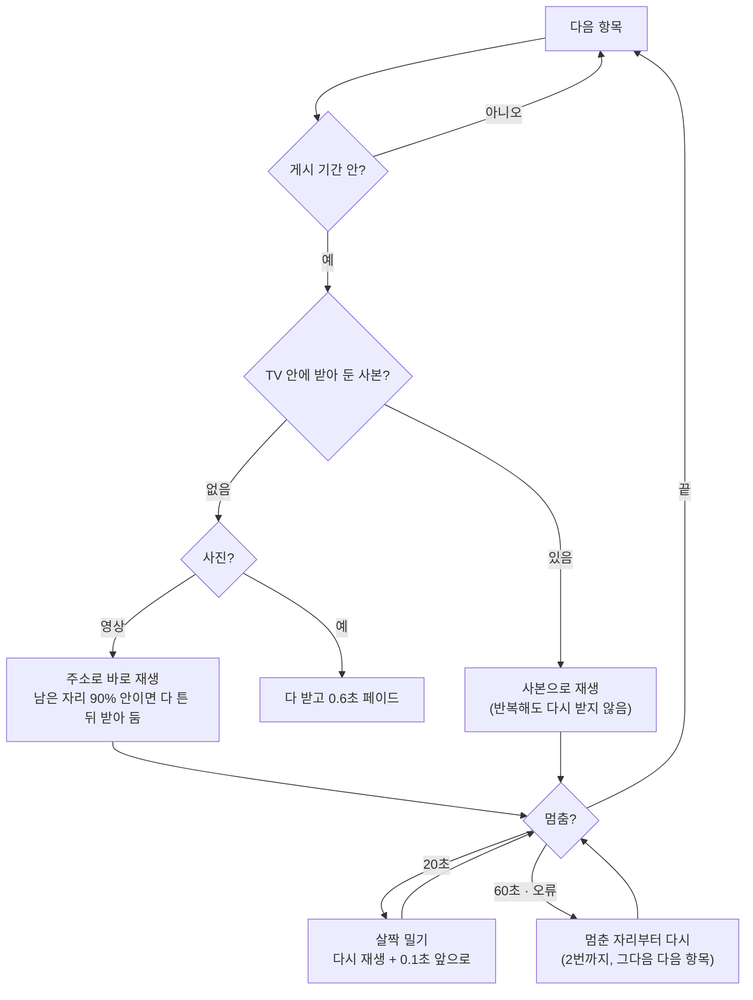

- **미리 받기는 기다린다.** 인터넷으로 트는 영상을 끝까지 받기 전에는 다음 항목을 받지 않는다. 느린 망에서 속도를 나눠 쓰면 지금 영상이 멈춘다.
- **스스로 새로 고친다.** 한 바퀴를 3번 연달아 못 띄우면 페이지를 새로 고친다(30분에 한 번까지). 새 버전을 배포하면 10분 안에 `tv.html` 의 스크립트 주소를 비교해 새로 고친다. 오래 켜 두면 새벽에도 새로 고친다.
- **1분마다 한 줄로 보고한다** (500자 안). 항목마다 받아 뒀는지를 `s·g·w·d·x` 한 글자로 보내고, 받는 속도, 저장 공간, 스스로 회복한 일(`nt·na·ni`), 진짜 문제(`err·ea·ei`)도 함께 보낸다.

### TV 본체 제어 — 클라우드 화면에서 내부망 TV 까지

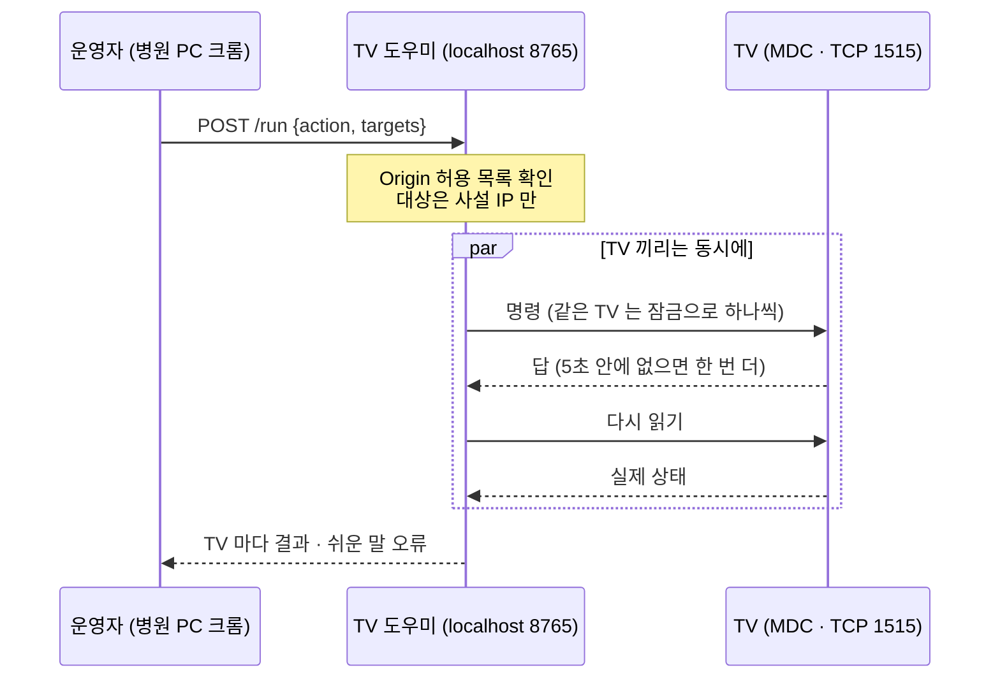

### 영상 업로드 — 올리기 전에 다시 만든다

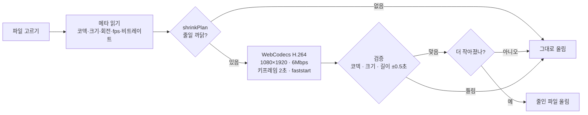

### 데이터 모델

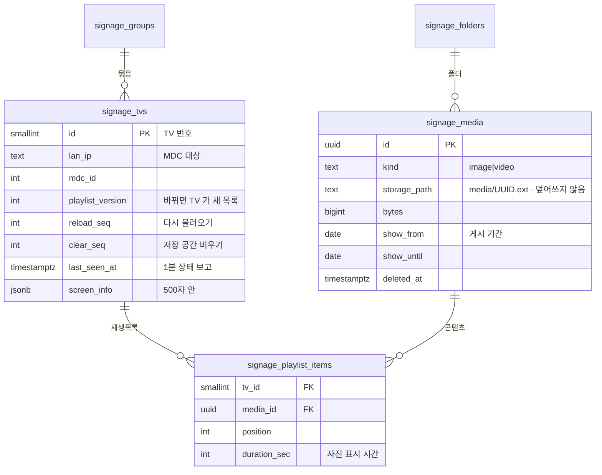

<sub>그 밖에 <code>signage_secret</code>(PIN 해시와 틀린 횟수) · <code>signage_upload_grants</code>(PIN 으로 받은 올리기 자리) · <code>signage_settings</code>(꺼짐 알림 시간). 모든 표는 anon·authenticated 권한을 거뒀다.</sub>

### 디렉터리 구조 (이 모듈만)

```
.
├── src/
│   ├── signage/              # 관리 화면 앱 — PIN 게이트 · 네 메뉴 라우팅
│   ├── features/signage/     # 화면 조각과 순수 함수(*.ts + 테스트)
│   │   ├── shrinkPlan.ts     #   줄일지 판단 · 검증 (테스트)
│   │   ├── shrinkVideo.ts    #   WebCodecs 변환 (mediabunny, 올릴 때만 불러옴)
│   │   ├── helper.ts · mdc.ts#   병원 PC 도우미 호출 · MDC 대상
│   │   └── control/          #   전원·예약
│   └── tv/                   # TV 재생 페이지 — React 없이
│       ├── main.ts           #   재생 · 받기 · 상태 보고
│       └── logic.ts          #   멈춤·이어 틀기·받을 자리 판단 (테스트)
├── tv.html                   # 재생 페이지 진입점 (따로 묶임)
├── public/tv-helper/         # 도우미 (Python) · Windows 설치 파일 · 맥 설치 · 영상 검사
└── supabase/migrations/      # 0087–0093
```

---

## 🧭 설계 결정

### 1. 서버 명령 큐 대신, 브라우저가 localhost 도우미를 부른다

클라우드는 병원 내부망(사설 IP)에 있는 TV 에 닿지 못한다. 처음에는 "서버 명령 큐 + PC 에이전트" 를 설계했다. 에이전트가 3~5초마다 명령을 가져가고, 명령은 2분 뒤 만료되는 방식이다.
그런데 운영자는 병원 PC 에서 관리 화면을 연다. 그래서 **그 브라우저가 같은 PC 의 도우미(`127.0.0.1`)를 바로 부르게** 했다.

- 공유기 포트를 열 필요가 없고, PC 에 둘 키도 없다. 큐 테이블과 폴링도 필요 없다.
- 다른 사이트가 도우미를 부르지 못하도록 Origin 허용 목록을 둔다. 크롬의 Private Network Access 사전 요청에도 답한다.
- PC 가 꺼져 있으면 버튼만 잠긴다. 재생은 TV 와 클라우드가, 예약은 TV 본체 타이머가 맡는다.

### 2. 예약은 TV 본체에, 명령 뒤에는 다시 읽는다

- 매일 켜고 끄기는 TV 자체 타이머(`timer_15`, 1~7번)에 쓰고, 다시 읽어 맞는지 확인한다. PC 가 꺼져 있어도 TV 가 알아서 켜지고 꺼진다.
- MDC 는 답이 늦거나 비어도 실제로는 적용됐을 수 있다. 그래서 성공 여부는 상태를 다시 읽어 정한다.
- 꺼진(대기) TV 는 화면 켜기와 입력 바꾸기를 거절한다. 이럴 때 도우미는 전원부터 켠다.
- 0시대와 12시대 시각은 받지 않는다. 라이브러리가 12시간제로 바꾸면서 12시를 0시로 읽는 문제가 있다.
- 설정 초기화(`reset`)와 연결 방식 변경(`mdc_connection`)은 아예 넣지 않았다.

### 3. 올리는 순간, 브라우저가 다시 만든다

TV 가 보고한 화면 크기는 864×1536 × 1.25, 곧 **1080×1920** 이었다. 올라온 4K 영상(2160×3840 · 약 15Mbps · H.264 Level 6)은 받고 풀기만 무겁고 보이는 화질은 같았다. TV 저장 공간은 80MB 남짓이다.

- `shrinkPlan` 은 해상도가 상자보다 크거나, 8Mbps 를 넘거나, H.264 가 아니거나, 31fps 를 넘으면 줄이기로 정한다. 순수 함수라 테스트가 있다.
- 변환은 mediabunny(WebCodecs)로 한다: H.264 · 6Mbps · 키프레임 2초 · faststart. 회전 정보는 화면에 구워 넣는다. TV 가 회전 정보를 무시해도 바르게 나온다. 소리는 TV 에서 안 나오니 뺀다.
- 만든 파일을 다시 열어 코덱, 크기, 길이(±0.5초)를 확인한다. 틀리거나 원본보다 커지면 **원본**을 올린다.
- 사진은 1080×1920 보다 클 때만 그 안으로 줄이고, 형식은 그대로 둔다. PNG 는 무손실 그대로 둔다.
- 변환 라이브러리(약 700KB)는 영상을 올릴 때만 불러온다. 평소 관리 화면은 받지 않는다.

### 4. 파일 경로를 덮어쓰지 않는다

콘텐츠를 바꾸면 새 UUID 경로로 올리고 재생목록 버전을 올린다. TV 는 경로(버전)마다 한 번만 받으므로, 캐시 무효화를 따로 신경 쓸 필요가 없다. 1년짜리 HTTP 캐시를 그대로 써도 옛 파일이 나오지 않는다.

### 5. 보안: 로그인 없는 화면이라 DB 와 도우미가 지킨다

| 위협 | 대응 |
|---|---|
| 관리 화면을 아무나 쓰기 | PIN 하나. 서버에는 소금 친 해시만 둔다. 10분에 10번 틀리면 10분 쉰다. 모든 작업은 `signage_admin` 이 매번 확인한다 |
| 표를 직접 읽거나 쓰기 | 모든 표에서 anon·authenticated 권한을 거뒀다. `security definer` RPC 만 열려 있다 |
| TV 주소로 다른 정보 보기 | TV 는 자기 목록만 받고(`signage_tv_feed`), 쓸 수 있는 것은 상태 보고(`signage_heartbeat`)뿐이다 |
| 파일 덮어쓰기·추측 | 경로는 UUID 다. 올리기는 PIN 으로 받은 자리에만 된다. 같은 경로는 덮어쓰지 않는다. 지우기는 어디에도 안 쓰는 파일만 된다 |
| 다른 사이트가 도우미 부르기 | Origin 허용 목록을 둔다. 대상은 사설 IP 만 받는다. 위험 명령은 넣지 않았다. 업데이트는 허용한 사이트에서만 받고, 파이썬으로 읽히는지 확인한 뒤 교체한다 |
| 환자 정보 노출 | TV 화면은 주소만 알면 보인다. 그래서 홍보 콘텐츠 전용으로 운영 규칙에 적었다 |

### 6. 설치는 파일 하나, 이후는 버튼 하나

- Windows 설치 파일은 Python 을 PATH 에서 찾고, 없으면 설치 폴더와 새 Python 설치 관리자 위치까지 찾는다. 이어서 라이브러리를 깔고, PC 를 켤 때 창 없이 실행되게 시작프로그램에 등록한다. 한글 사용자 폴더 경로가 깨지지 않도록 CP949 와 짧은 경로(8.3)를 쓴다.
- 맥은 터미널 한 줄로 설치한다. launchd 에 등록해 켤 때마다 자동으로 실행된다.
- 그 뒤로는 관리 화면의 [업데이트] 를 누른다. 도우미가 새 파일을 받아 스스로 바꾸고 다시 켠다. 도우미는 이렇게 v1 에서 v7 까지 올라왔다.

---

## 🔧 현장 문제 해결

실제 TV 에 붙이자 문서에 없던 문제가 나왔다. 원인은 TV 가 1분마다 보내는 상태 보고에서 찾았다. 고치기 전에는 Playwright 로 느린 망, 멈춤, 끊김을 흉내 낸 가짜 네트워크에서 재생 페이지를 돌려 같은 문제를 먼저 재현했다.

| 현장 증상 | 상태 보고로 찾은 원인 | 고친 것 |
|---|---|---|
| "같은 영상이 TV2 에선 되는데 TV1 에선 못 읽어요" | TV1 저장 공간이 67MB / 80MB 였다. 게다가 예전 화면에 머물러 새 명령을 못 알아들었다 | 자리가 모자라면 받지 않고 바로 튼다 · 배포하면 TV 가 스스로 새로 고친다 · [저장 공간 비우기] 버튼 |
| "영상 하나만 넣은 TV 가 앞부분만 반복해요" | 틀면서 같은 파일을 또 받다가 느린 망에서 멈췄고, 그때마다 처음부터 다시 틀었다 | 멈춘 자리부터 이어 튼다 · 첫 바퀴를 다 돈 뒤에 받아 둔다 |
| "30초 영상이 중간에 잘려요" | 다음 항목을 미리 받느라 속도를 나눠 썼다. 그래서 멈췄고, 멈추자 다음 항목으로 넘어갔다 | 지금 영상을 다 받기 전에는 미리 받지 않는다 · 같은 영상을 멈춘 자리부터 다시 튼다 |
| 4K 영상(약 15Mbps)이 무겁다 | 화면 크기 보고가 1080×1920 이었다. 4K 는 받고 풀기만 무거웠다 | 올릴 때 최적화 · 병원 PC 에서 폴더째 영상·사진을 검사하는 도구 |
| "잘 나오는데 '확인 필요' 가 떠요" | 스스로 회복한 멈춤까지 오류로 보고했다 | 회복한 일은 회색 "최근 기록" 으로, 진짜 실패만 "확인 필요" 로 |

---

## 🧪 테스트

```bash
npm run typecheck && npm run lint && npx vitest run && npm run build
./scripts/verify-sql.sh          # 빈 Postgres 에 전체 마이그레이션 → 두 번 더 적용(멱등) → RLS·권한 회귀
node scripts/shots/smoke.mjs     # 가짜 Supabase 로 모든 화면 열기 (관리 화면 네 메뉴 · 휴대폰)
```

- **단위 49개** — 재생 판단(`stallStep` · `resumePoint` · `bufferedAll` · `fitsCache` · `itemFlags` · `newBuild`), 업로드 판단(`shrinkPlan` · `imagePlan` · `verifyVideo`), MDC 대상, 설치 파일의 사이트 주소 바꾸기(CP949 바이트 그대로), 화면 계산.
- **재생 재현** — 시나리오마다 Playwright 와 실제 Chrome(H.264)으로 TV 페이지를 띄우고, 가짜 네트워크로 속도와 끊김을 조절하며 확인했다.
- **도우미** — `--fake` 로 가짜 TV 9대를 띄워 전원, 입력, 예약, 껐다 켜기 흐름을 시험한다.

---

## ⚙️ 운영

| | |
|---|---|
| **꺼짐 알림** | 알림 시간(기본 월~토 09:00~21:00) 안에 신호가 10분 넘게 없으면 관리자 휴대폰으로 웹 푸시. pg_cron 이 5분마다 확인한다 |
| **원격 복구** | [다시 불러오기] 와 [저장 공간 비우기] 는 TV 가 20초 안에 받는다. [TV 껐다 켜기] 는 도우미로 한다 |
| **자동 갱신** | 배포하면 TV 화면은 10분 안에, 도우미는 버튼 하나로 새 버전이 된다 |
| **진단** | 상태 보기의 받는 속도를 TV 끼리 비교한다. 한 TV 만 낮으면 그 TV 의 네트워크 문제다 |

---

## 🗺 추후 개선

- [ ] **인터넷이 끊겨도 재생** — Tizen 앱을 만들어 본체 저장소에 받아 두기. TV 1대로 먼저 시험한다
- [ ] **PC 가 꺼져 있어도 원격 명령** — 처음 설계한 서버 명령 큐 + 에이전트 (명령 유효 2분, 지난 명령은 실행하지 않음)
- [ ] **실기 확인** — 꺼진 TV 에 화면 켜기, TV 껐다 켜기, 꺼짐 푸시 알림을 실제 TV 에서 확인 (지금은 가짜 TV 로만 시험)

---

## 📝 변경 이력

| 날짜 | 내용 |
|---|---|
| **11-09** | 올릴 때 영상·사진 최적화와 검증 · 영상 하나뿐인 TV 이어 틀기 · 여러 영상 TV 잘림 고침 · 재생 방식 버튼과 표시 · 콘텐츠 탐색기 · 병원 PC 영상 검사 · 스스로 회복한 일은 "최근 기록" |
| 11-08 | 배포하면 TV 가 스스로 새로 고침 · [저장 공간 비우기] (0093) · 받는 동안 바로 틀기 · 받는 속도와 남은 공간 |
| 11-07 | 전원·예약 탭 · 설치 파일 하나 · 게시 기간과 저장 공간 (0090) · TV 묶음과 꺼짐 휴대폰 알림 (0091) · [다시 불러오기] (0092) · 맥 설치 · 도우미 3 → 7 · 디자인 개편 |
| **11-06** | 첫 판 — PIN 관리 화면 · TV 재생 페이지 (0087) · 짧은 주소 (0088) · 콘텐츠 폴더 (0089) · 상태 보기 · 병원 PC 도우미 |

---

<sub>소스 코드는 비공개 저장소에 있습니다. 코드 열람이 필요하면 연락 주세요 — firstsm41@naver.com</sub>
