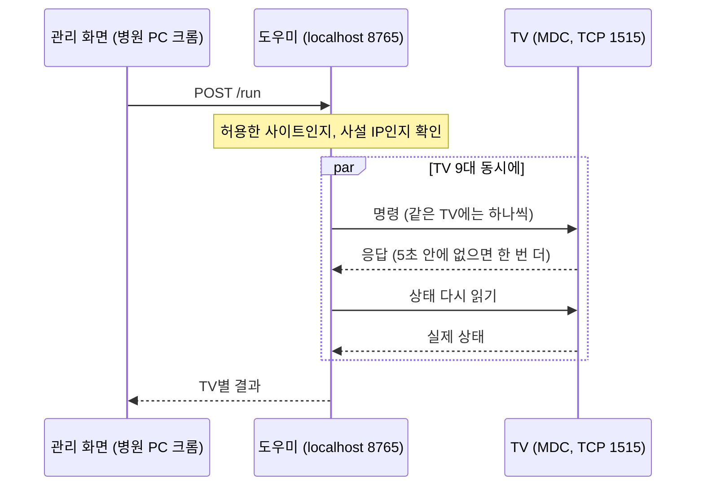
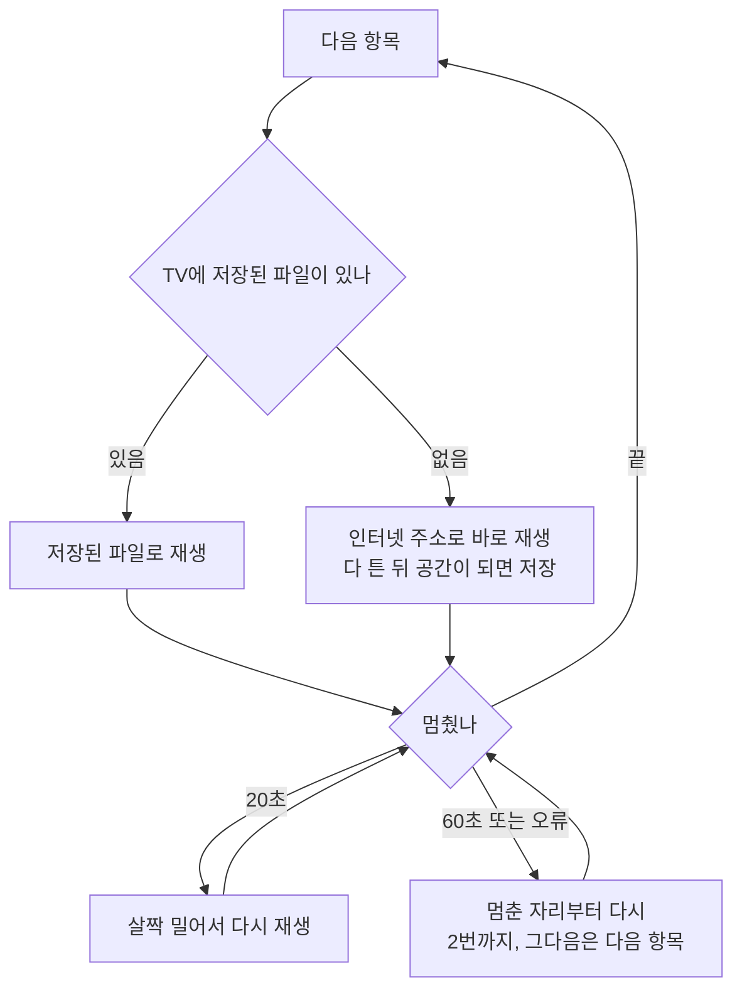

<div align="center">


# 스마트월

**병원 대기실 사이니지 TV 9대를 웹에서 관리하기**


[발표 자료 PDF](SmartWall-portfolio.pdf)


<sub>스크린샷은 직접 만든 데모 데이터로 찍었습니다. TV 이름, 콘텐츠, 주소는 실제와 다릅니다.</sub>

</div>

---

## 소개

한 의원의 대기실과 복도에 삼성 세로형 사이니지 TV가 9대 있습니다. 콘텐츠를 바꾸려면 TV마다 USB를 꽂아야 했고, 전원이나 입력을 바꿀 때는 MDC 명령어를 직접 입력해야 했습니다. TV가 꺼져 있어도 앞에 가 보기 전에는 알 수 없었습니다.

그래서 운영자가 웹 화면에서 사진과 영상을 올리고, TV마다 재생목록을 정하고, 전원과 예약까지 다룰 수 있게 만들었습니다. 병원에서 이미 쓰던 사내 앱(근무, 연차 관리)에 붙인 기능이고, 기획부터 개발과 TV 설치 현장 대응까지 혼자 했습니다.

| | |
|---|---|
| 기간 | 2026년 11월 6일 ~ 9일, PR 28개 |
| 역할 | 1인 개발 (기획, 설계, 프론트엔드, DB, 병원 PC 프로그램, 현장 대응) |
| 기술 | React 19, TypeScript, Vite, Supabase(PostgreSQL, Storage, Edge Functions, pg_cron), Vercel, Python, WebCodecs |
| 규모 | TV 9대, DB 마이그레이션 7개, 단위 테스트 49개 |

## 화면

운영자는 TV 9대에 지금 무엇이 나오는지 보면서 관리합니다. 화면에 보이는 "지금 나오는 콘텐츠"는 TV가 1분마다 알려 준 재생 순서와 시각으로 매초 계산한 값입니다.

<div align="center">

</div>

재생목록에서는 각 항목을 TV에 저장했는지, 인터넷으로 트는 중인지 보입니다. 상태 보기에는 TV가 보낸 저장 공간과 받는 속도, 병원 PC 도우미가 읽은 TV 본체의 전원과 입력이 같이 나옵니다.

<div align="center">


</div>

콘텐츠는 폴더로 정리하고, 게시 기간을 정할 수 있습니다. 전원과 예약은 TV를 하나씩, 묶음으로, 또는 전체로 골라서 보냅니다. 휴대폰에서도 같은 화면을 쓸 수 있습니다.

<div align="center">

<br/>


</div>

## 구조


세 부분으로 나눴습니다.

- **관리 화면**은 React로 만들었습니다. 로그인 대신 PIN으로 들어가고, 모든 작업은 DB 함수 `signage_admin` 하나를 거칩니다.
- **TV 재생 페이지**는 TV 브라우저(Tizen 7)에서 가볍게 돌도록 React 없이 따로 만들었습니다. 20초마다 재생목록이 바뀌었는지 확인하고, 1분마다 자기 상태를 서버에 보냅니다.
- **병원 PC 도우미**는 Python으로 만들었습니다. 그 PC의 `127.0.0.1:8765`에서 돌면서 삼성 MDC 프로토콜로 TV 전원, 입력, 예약을 다룹니다.

## 만들기 전에 정리한 조건

| 조건 | 그래서 이렇게 했습니다 |
|---|---|
| 클라우드에서는 병원 내부망의 TV에 직접 연결할 수 없습니다 | 병원 PC에 도우미를 두고, 그 PC의 브라우저가 도우미를 부르게 했습니다 |
| 병원 PC는 근무 시간에만 켜져 있습니다 | 재생은 TV와 클라우드만으로 돌게 하고, 매일 켜고 끄는 예약은 TV 본체 타이머에 넣었습니다 |
| TV 브라우저에 저장할 수 있는 공간이 80MB 정도입니다 | 영상은 받으면서 바로 틀고, 공간이 모자라면 저장하지 않고 인터넷으로만 틀게 했습니다 |
| 쓰는 사람이 병원 운영자입니다 | 설치는 파일 하나, 업데이트는 버튼 하나로 끝나게 했습니다. 도우미는 이렇게 7번 업데이트됐습니다 |

## 고민했던 것

### 내부망 TV를 켜고 끄는 방법

처음에는 서버에 명령을 쌓아 두고 병원 PC 프로그램이 몇 초마다 가져가는 방식을 설계했습니다. 이 방식은 PC가 꺼져 있는 동안 명령이 쌓이기 때문에, 밤에 누른 "끄기"가 다음 날 아침에 실행되지 않도록 만료 처리가 필요합니다. PC에 서버 접속 키도 둬야 합니다.

운영자는 항상 병원 PC에서 관리 화면을 연다는 점을 보고, 브라우저가 같은 PC의 도우미를 바로 부르는 방식으로 바꿨습니다. 키가 필요 없고, 허용한 사이트에서 온 요청만 받으면 됩니다. PC가 꺼져 있을 때 밖에서 TV를 끄는 기능은 포기했습니다. 대신 매일 켜고 끄는 일은 TV 본체 타이머에 맡겼습니다.



MDC는 응답이 늦거나 비어 있어도 실제로는 적용된 경우가 있어서, 성공 여부는 상태를 다시 읽어서 판단합니다. 꺼진 TV는 화면 켜기나 입력 바꾸기를 거절하기 때문에, 그럴 때는 전원부터 켜고 보냅니다. 쓰던 MDC 라이브러리가 12시를 0시로 읽는 문제가 있어서 예약 시각에서 0시대와 12시대는 받지 않습니다.

### 권한

관리 화면은 로그인 없이 PIN으로 씁니다. 그래서 화면에서 막는 것만으로는 부족하다고 보고 DB에서 막았습니다.

- 서버에는 PIN의 해시만 저장합니다. 10분 안에 10번 틀리면 10분 동안 막습니다.
- 모든 표에서 일반 권한을 회수했고, 정해 둔 DB 함수로만 접근할 수 있습니다.
- TV 페이지는 자기 재생목록만 받을 수 있고, 쓸 수 있는 것은 상태 보고뿐입니다.
- 파일 경로는 UUID이고 같은 경로를 덮어쓰지 않습니다. 파일을 바꾸면 새 경로로 올리고 재생목록 버전을 올리기 때문에 TV 캐시가 꼬이지 않습니다.
- 도우미는 허용한 사이트에서 온 요청만 받고, TV 설정 초기화 같은 위험한 명령은 아예 넣지 않았습니다.

## 현장에서 생긴 문제

실제 TV에 붙이고 나서 생긴 문제들입니다. 원인은 TV가 1분마다 보내는 상태 보고를 보고 찾았습니다.

### 같은 영상이 TV2에서는 나오는데 TV1에서는 나오지 않았습니다

TV1의 저장 공간이 80MB 중 67MB가 차 있었습니다. 게다가 TV1은 예전 버전 페이지에 머물러 있어서 [다시 불러오기]도 알아듣지 못했습니다. 그날은 리모컨으로 TV 브라우저 기록을 지워서 복구했습니다.

그 뒤로는 남은 공간이 모자라면 파일을 저장하지 않고 인터넷으로만 틀게 했습니다. 새 버전을 배포하면 TV 페이지가 10분 안에 스스로 새로 고치게 했고, 관리 화면에서 TV 저장 공간을 비울 수 있게 했습니다.

### 느린 망에서 영상이 앞부분만 반복되거나 중간에 잘렸습니다

영상을 하나만 넣은 TV는 앞부분만 반복했고, 영상이 여러 개 도는 TV에서는 30초짜리 영상이 중간에 끊겼습니다. 둘 다 영상을 틀면서 다른 파일을 동시에 받고 있었던 게 원인이었습니다. 속도를 나눠 쓰니 재생이 멈췄고, 멈추면 처음부터 다시 틀거나 다음 항목으로 넘기게 되어 있었습니다.

지금은 멈추면 멈춘 자리부터 이어서 틀고, 지금 영상을 끝까지 받기 전에는 다음 영상을 받지 않습니다. 고치기 전에 Playwright로 TV 페이지를 띄우고 네트워크를 일부러 느리게 만들어 같은 증상을 먼저 재현했습니다.



### 4K 영상이 화질 차이 없이 무겁기만 했습니다

TV가 보고한 화면 크기는 864×1536에 배율 1.25, 실제로는 1080×1920이었습니다. 병원 PC에 모아 둔 영상은 다섯 개 모두 2160×3840, 초당 약 15Mb였습니다.

영상을 올리는 순간 브라우저에서 1080×1920 H.264로 다시 만들게 했습니다. 크롬의 WebCodecs를 쓰기 때문에 서버가 따로 필요 없습니다. 만든 파일은 다시 열어서 코덱, 크기, 길이를 원본과 비교하고, 맞지 않거나 오히려 커지면 원본을 그대로 올립니다. 기존 영상 다섯 개를 같은 기준으로 줄였더니 합계가 208.7MB에서 59.7MB가 됐습니다.

### 잘 나오는데 "확인 필요"가 떴습니다

TV가 스스로 회복한 멈춤까지 오류로 보고하고 있었습니다. 회복한 일은 회색 "최근 기록"으로만 보이게 하고, 사람이 손대야 하는 경우에만 "확인 필요"가 뜨게 바꿨습니다.

## 테스트

```bash
npm run typecheck && npm run lint && npx vitest run && npm run build
./scripts/verify-sql.sh          # 빈 Postgres에 마이그레이션을 세 번 적용하고 권한 테스트
node scripts/shots/smoke.mjs     # 가짜 Supabase로 모든 화면 열어 보기
```

재생과 업로드에서 판단하는 부분(언제 기다리고 언제 다시 틀지, 영상을 줄일지, 다시 만든 영상이 맞는지)은 순수 함수로 빼서 단위 테스트를 붙였습니다. 병원 PC 도우미는 `--fake` 옵션으로 가짜 TV 9대를 띄워서 시험합니다.

## 아쉬운 점과 다음에 할 일

처음에는 TV 상태 보고를 간단하게만 넣었습니다. 그래서 초반 문제는 원인을 찾는 데 시간이 더 걸렸습니다. 저장 공간, 받는 속도, 항목별 저장 상태를 처음부터 보냈다면 더 빨랐을 것 같습니다.

꺼진 TV에 화면 켜기, TV 재부팅, 꺼짐 푸시 알림은 아직 실제 TV에서 확인하지 못했고 가짜 TV로만 시험했습니다.

다음에는 인터넷이 끊겨도 재생되도록 TV 전용 앱(Tizen)을 TV 한 대로 시험해 보려고 합니다. 병원 PC가 꺼져 있을 때도 명령을 보낼 수 있게 처음에 설계했던 서버 명령 방식을 추가하는 것도 생각하고 있습니다.

---

<sub>소스 코드는 비공개 저장소에 있습니다. 코드를 보셔야 하면 firstsm41@naver.com으로 연락 주세요.</sub>
